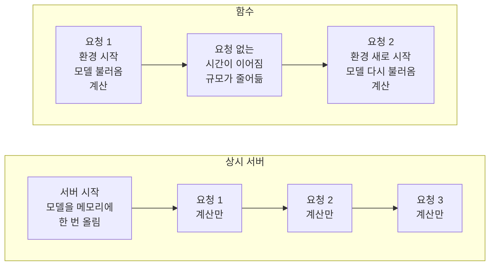
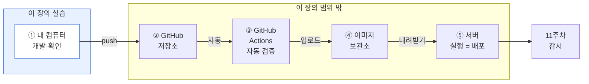
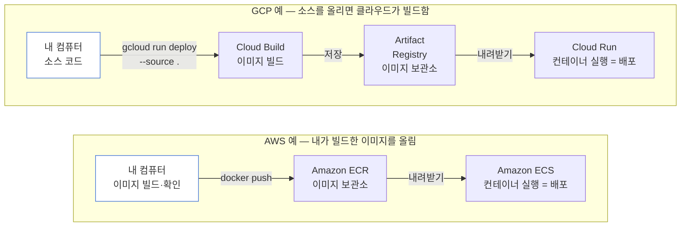

# 10주차 모델을 어떻게 내보내고, 무엇으로 통과시키는가

> **10주차 · 모델 배포와 CI/CD**
>
> 이 장의 수치는 대부분 `practice/chapter10/`의 코드를 실행해 얻은 값이다. 인용한 값의 출처 파일은 출력 블록 첫 줄에 적었다. 실행하지 않은 숫자는 5절에서 배포 방법 세 가지를 비교할 때 쓴 "요청 6건 중 1건" 하나뿐이며, 그 자리에 가정이라고 밝혔다.
>
> 한 가지 예외가 있다. Docker 컨테이너에서 서빙 API를 띄운 결과는 이 강의 환경에서 다시 돌릴 수 없어 **과거 실행이 남긴 산출물에서 옮긴 값**이며, 그 블록의 출처는 `practice/chapter10/data/output/`으로 적었다.

□ 9주차에서 champion 별칭까지 붙은 모델은 아직 실습 스크립트 안에서만 실행됨
  ○ 이용자는 스크립트를 실행하지 않음. 다른 프로그램이 요청을 보내면 답을 돌려주도록, 모델을 서버에서 계속 실행해 두어야 함
  ○ 이 장은 모델을 서버에서 실행하기 전에 무엇을 확인하는지를 다룸

### 용어 먼저 — 이미지, 컨테이너, 상시 서버, 함수

□ **이미지**: 코드, 패키지, 설정, 모델 파일을 한 묶음으로 담은 파일임. 한 번 만들면 바뀌지 않음
  ○ 이 장의 이미지: Dockerfile이 "`python:3.13-slim` 위에 `requirements-serve.txt`의 패키지를 설치하고 `app.py`와 champion 모델 파일을 넣는다"고 적고 있으며, `docker build`로 만듦
□ **컨테이너**: 이미지를 실행한 것임. 같은 이미지로 컨테이너를 여러 개 띄울 수 있고, 컨테이너를 지워도 이미지는 그대로 남음
  ○ 이 장: `docker run`을 실행하면 앱이 8000번 포트에서 요청을 기다림(Dockerfile의 `EXPOSE 8000`, `uvicorn`)
  ○ 이미지 안에 실행 환경이 들어 있으므로 어느 컴퓨터에서 실행해도 같은 환경에서 돌아감. 다만 그 환경이 저장소의 폴더 구조와 다르면 6절처럼 경로 오류가 남
□ **상시 서버**: 프로그램을 계속 켜 두고, 요청이 오면 그 프로그램이 답함
  ○ 이 장의 서빙 앱이 이 방식이며, 켤 때 모델을 한 번 메모리에 올림(4절)
□ **함수**: 요청이 올 때 코드를 실행하는 방식이며, 서버를 켜고 끄는 일은 클라우드가 맡음
  ○ Vercel의 기본값(Vercel 문서): 실행 시간 300초, 메모리 2 GB, 요청·응답 크기 4.5 MB
  ○ Vercel의 컨테이너 실행 문서(베타)에 따르면, 요청이 없는 채로 운영 환경에서 5분이 지나면 함수의 규모가 줄어듦
  ○ 규모가 줄어든 뒤 첫 요청에서는 실행 환경이 새로 시작되고, 모델 앱이면 앱이 시작될 때 하는 모델 불러오기를 다시 함. 그래서 그 요청만 응답이 느려질 수 있음(추정이며 이 장에서 측정하지 않음)
□ 함수와 상시 서버는 실행 방식이고, 컨테이너는 두 방식 모두에 쓰임. Vercel은 컨테이너 이미지를 함수로 실행함(베타)



**그림 10.1** 상시 서버와 함수에서 요청이 올 때 일어나는 일. 함수의 "모델 다시 불러옴"은 추정이며 이 장에서 측정하지 않음

### 웹페이지 배포와 모델 앱 배포

□ 서버에 올리는 앱은 세 가지로 나뉘며, 올리는 것과 서버에서 하는 일이 다름

| 구분 | 정적 페이지 | 동적 기능 (함수) | 동적 기능 (상시 서버·컨테이너) |
|---|---|---|---|
| 올리는 것 | HTML·이미지 같은 완성된 파일 | 요청을 받아 계산하는 코드 | 코드와 패키지를 담은 이미지 |
| 서버에서 코드 실행 | 없음. 파일만 내려줌 | 요청이 올 때 실행함 | 켜 놓고 계속 실행함 |
| 예 | 소개 페이지, 문서 | 로그인, 문의 폼 | 이 장의 모델 서빙 API |
| 코드가 고장 났을 때 | 화면이 깨져 바로 보임 | 오류 응답이 나서 바로 보임 | 오류 응답이 나서 바로 보임 |

**표 10.1** 서버에 올리는 앱의 세 가지 종류. 정적 페이지 설명은 일반 설명이며 문서로 확인하지 않음

□ 웹페이지를 Vercel에 올려 본 적이 있다면, 그 절차가 그림 10.2의 ②~⑤를 한 서비스 안에서 처리한 것임
  ○ GitHub 저장소를 연결하면 브랜치에 push할 때마다 자동으로 배포하고, 운영 브랜치에 합치면 운영 배포를 만듦(Vercel Git 문서)
  ○ 프로젝트 최상위에 Dockerfile을 두면 Vercel이 이미지를 빌드해 자체 이미지 보관소(Vercel Container Registry)에 저장하고 함수로 실행함(Vercel Docker 문서, 베타)
  ○ 같은 절차를 모델 앱에도 쓸 수 있음. 올리는 방법은 같고, 올린 뒤 확인할 것이 다름
□ GitHub Actions와 Vercel 빌드는 둘 다 빌드를 하지만 역할이 다름
  ○ GitHub Actions: 저장소의 `.github/workflows` 폴더에 YAML 파일로 적어 둔 작업(테스트, 빌드, 배포 등)을 순서대로 실행함. 결과물을 어디에 올릴지도 내가 적음(GitHub Actions 문서)
  ○ Vercel 빌드: 프로젝트 설정(프레임워크, 빌드 명령, 출력 설정, 환경 변수)대로 빌드하고, 그 결과를 Vercel에 배포함(Vercel Git 문서)
  ○ 둘을 함께 쓸 수도 있음. Vercel 문서가 GitHub Actions나 Vercel CLI로 배포하는 경우를 설명함
  ○ 모델 앱은 빌드 전에 `pytest`나 검수표 같은 검증을 실행해야 하므로, 명령을 직접 적을 수 있는 GitHub Actions를 그림 10.2의 ③에 둘 수 있음. 읽어 본 Vercel 설정 목록에는 테스트 실행 항목이 없었으며, 빌드 명령에 넣을 수 있는지는 확인하지 못함
□ 모델 앱은 위 세 방식 어디에 올려도 코드가 정상인데 예측값이 틀릴 수 있음. 모델 앱에만 더 필요한 것은 다음과 같음
  ○ 모델 파일과 버전: 어느 버전이 답했는지 응답에 남김(4절)
  ○ 오류 없이 틀림: 서버가 정상이어도 입력이 바뀌면 예측이 어긋남(11주차)
  ○ 새 버전 검증: 실제 요청에서 틀리는지는 배포한 뒤에야 알 수 있어 shadow로 시험함(5절)
  ○ 모델 앱과 일반 동적 앱이 함께 필요한 것: 비밀키 관리, 데이터베이스 구조 변경 시 되돌리기
□ 모델이 Vercel의 기본 한도에 걸리는 곳(Vercel 문서, 갱신일 2026-08-24 문서를 2026-11-01에 확인)
  ○ 함수 크기(압축 해제 후) 250 MB, Python은 500 MB. 5 GB까지 올리는 대형 함수는 베타임
  ○ 요청·응답 크기 4.5 MB, 실행 시간 기본 300초, 메모리 기본 2 GB. 한도는 바뀔 수 있으므로 올리기 전에 문서를 다시 확인함

> - **출처 (2026-11-01에 열어 확인)**
> - GitHub Actions 개념: https://docs.github.com/en/actions/get-started/understand-github-actions
> - Vercel 함수 한도: https://vercel.com/docs/functions/limitations
> - Vercel Git 연동: https://vercel.com/docs/git
> - Vercel Docker 실행: https://vercel.com/kb/guide/docker

### 모델이 서버에서 운영되기까지의 두 경로

□ 서버에 올리는 경로는 둘이며, 둘 다 이미지가 보관소를 거쳐 서버에서 실행된다는 점은 같음
  ○ 경로 1은 GitHub를 거치는 경로로, 팀으로 개발할 때 흔함
  ○ 경로 2는 내 컴퓨터에서 클라우드(AWS, GCP)로 바로 올리는 경로임
  ○ 두 그림에서 파란 칸이 이 장의 실습 범위이고, 나머지는 이 장의 범위 밖임

#### 경로 1. GitHub를 거치는 경로



**그림 10.2** GitHub를 거쳐 코드가 서버의 컨테이너로 실행되기까지의 흐름. ①만 이 장에서 실습함

□ 단계마다 하는 일
  ○ ① 개발·확인: 내 컴퓨터에서 앱을 만들고, 컨테이너 이미지를 만들어 같은 요청에 같은 답이 나오는지 확인함(선택 실습, 아래 2절)
  ○ ② GitHub 저장소: 코드와 Dockerfile을 보관하고, 누가 언제 무엇을 바꿨는지 기록함. 내 컴퓨터의 코드를 `git push`로 올리면 다음 단계가 시작됨
  ○ ③ GitHub Actions: 저장소에 코드가 올라올 때마다 정해 둔 검증(테스트, 이미지 빌드)을 사람 대신 자동으로 실행함. 6절 끝에서 말하는 CI가 이 단계임
    – 이 저장소의 `.github/` 폴더에는 `copilot-instructions.md` 하나뿐이고 CI 설정 파일이 없음. 6절 검수표 8번 항목이 미달로 나온 이유가 이것임
  ○ ④ 이미지 보관소(컨테이너 레지스트리): 검증을 통과한 이미지에 버전 이름을 붙여 보관함. GitHub도 이 용도의 보관소(Container registry)를 제공함
  ○ ⑤ 서버: 보관소에서 이미지를 내려받아 컨테이너로 실행함. 이 실행이 배포이고, 11주차의 감시는 이 뒤부터 시작함
□ 원칙은 검증을 통과한 그 이미지를 그대로 서버에서 실행하는 것임
  ○ 올린 뒤 어딘가에서 이미지를 다시 빌드하면, 고정하지 않은 부분(기본 이미지 `python:3.13-slim`의 갱신, 버전을 적지 않은 하위 패키지)이 달라질 수 있음
  ○ 그러면 서버의 이미지는 검증한 이미지와 다른 이미지가 됨. 6절 [4]에서 줄 내용이 같아도 해시가 다르면 다른 파일로 보는 것과 같은 이유임

#### 경로 2. 내 컴퓨터에서 클라우드로 바로 올리는 경로

□ GitHub 없이도 올릴 수 있음. 이 경우 ②저장소와 ③자동 검증이 빠지고, 이미지 보관소와 서버 실행은 그대로 있음
  ○ 클라우드마다 올리는 방식이 다르며, 아래는 두 클라우드의 공식 문서에 적힌 방식임



**그림 10.3** 내 컴퓨터에서 클라우드로 바로 올리는 두 경로. 이 장에서는 실습하지 않음

> - **출처**
> - AWS: 내 컴퓨터에서 `docker build`로 이미지를 만들고, `docker push`로 Amazon ECR(이미지 보관소)에 올린 뒤, 그 이미지를 Amazon ECS 작업 정의에서 지정해 실행함. https://docs.aws.amazon.com/AmazonECS/latest/developerguide/create-container-image.html
> - GCP: `gcloud run deploy --source`가 소스 코드를 올리면 Cloud Build가 이미지를 만들고 Artifact Registry에 저장함. 소스 폴더에 Dockerfile이 있으면 그 Dockerfile로 빌드함. https://docs.cloud.google.com/run/docs/deploying-source-code

□ 두 경로에서 다른 점
  ○ AWS 경로는 내 컴퓨터에서 확인한 이미지가 그대로 올라감. 이미지 보관소에 올리는 단계를 내가 직접 실행함
  ○ GCP 소스 경로는 명령 한 줄로 끝나 보이지만, 이미지는 클라우드에서 새로 빌드됨. 내 컴퓨터에서 확인한 이미지와 같은 이미지가 되려면 같은 Dockerfile을 쓰고 버전을 고정해야 함
  ○ 두 경로 모두 이미지 보관소 단계는 있음. GCP에서는 그 단계가 명령 안에서 자동으로 일어남
□ GitHub를 거치지 않고 바로 올리면 두 가지가 없음
  ○ 누가 언제 무엇을 올렸는지 남는 변경 이력
  ○ 올리기 전에 테스트를 자동으로 실행하는 단계. 사람이 테스트를 건너뛰고 올릴 수 있음

### 이 장의 범위와 그 뒤

□ 이 장의 실습은 ①까지이며 모두 내 컴퓨터 안에서 함. 그림 10.2의 ②~⑤와 그림 10.3의 클라우드 경로는 실습하지 않음
  ○ 필수 실습 1~4번은 컨테이너도 서버도 띄우지 않음. 표준 라이브러리 스크립트로 서빙 규칙을 다시 계산하고, 9주차 산출물과 과거 실행 기록을 읽어 비교함
  ○ 선택 실습은 내 컴퓨터에서 앱을 띄우고, Docker로 컨테이너를 만들어 같은 요청을 보내 봄
  ○ 두 경로 모두 GitHub 또는 클라우드 계정, 이미지를 실행할 서버, 비용이 필요하고, 외부망이 막힌 기관에서는 쓸 수 없는 경우가 있어 실습에 넣지 않음
□ 서버에 올리는 것까지 직접 해 볼지는 선택임
  ○ GitHub 경로를 해 보려면 9절의 GitHub Actions 문서에서 시작해, 코드를 올릴 때 이 장의 테스트와 이미지 빌드가 자동으로 실행되게 만드는 것이 첫 단계임
  ○ 클라우드 경로를 해 보려면 위 출처 상자의 AWS, GCP 문서를 따름
  ○ 하지 않아도 이 장의 실습과 과제를 마치는 데는 지장이 없음
□ 이 장도 설명과 실습을 나누지 않음
  ○ 절마다 실행할 명령이 나오고, 출력을 한 덩어리씩 끊어 그 바로 아래에서 설명함
  ○ 순서대로 실행하면 이 장의 수치를 직접 만들 수 있음

## 1. 오늘의 질문

□ 예측을 미리 만들어 둘 것인가, 요청이 도착한 순간 계산할 것인가?
□ 서빙 API가 "지금 어느 모델로 답하고 있는가"에 답하지 못하면 무엇을 잃는가?
□ 새 모델 후보를 이용자에게 위험을 주지 않고 실제 요청으로 시험해 볼 수 있는가?
□ 같은 확인을 왜 여러 단계에서 반복하는가?

## 2. 이 장에서 실행할 것

□ 모델을 내보내기 전에 다섯 가지를 확인하며, 각각 다른 절에서 실행함

| 확인할 것 | 어떻게 확인하는가 | 다루는 절 |
|---|---|---|
| 앱이 입력 규격과 응답 규격을 지키는가 | 서버를 띄우지 않고 앱 함수를 직접 호출해 요청 7건을 보냄 | 4 |
| 실제 프로세스로 띄워도 기동되는가 | 내 컴퓨터(호스트)에서 서빙 프로세스를 띄워 같은 요청을 보냄 | 6 |
| 환경이 바뀌어도 같은 답을 내는가 | 컨테이너에서 같은 요청을 보내고 두 답을 비교함 | 6 |
| 지금 어느 모델로 답하는지 말할 수 있는가 | 응답에 모델 이름·버전·불러온 곳 세 칸을 함께 넣음 | 4 |
| 새 후보를 이용자 위험 없이 시험할 수 있는가 | 요청을 후보에도 똑같이 보내되 이용자에게는 champion의 답만 돌려줌 | 5 |

**표 10.2** 이 장에서 실행하는 다섯 가지 확인

□ 셋째 확인(환경이 바뀌어도 같은가)은 숫자로 따로 확인함
  ○ 두 파일의 내용이 줄마다 똑같아도, 줄 끝 처리 방식(줄바꿈 규약) 하나만 다르면 sha256 해시가 달라짐
  ○ 그래서 배포에서는 "같은 코드인가"에서 멈추지 않고 "파일의 바이트가 같은가"까지 계산함. 6절 출력 [4]에서 그 차이를 숫자로 봄

□ 이 장에서 실행할 코드는 넷이며 순서가 정해져 있음

| 순서 | 실행할 파일 | 하는 일 | 절 | 선행 조건 |
| ---: | --- | --- | ---: | --- |
| 1 | `10-2-batch-vs-online.py` | 계산이 멈췄을 때 배치와 온라인에서 오류가 나는지 비교 | 3 | 9주차 산출물(저장소 포함) |
| 2 | `10-3-serving-contract.py` | 신원 응답과 입력 검증 규칙 적용 | 4 | 9주차 산출물 |
| 3 | `10-4-shadow-compare.py` | champion·challenger를 나란히 실행하고 후보 재평가 | 5 | 9주차 산출물 |
| 4 | `10-5-release-gate.py` | 배포 검수표 재계산과 바이트 비교 | 6 | 10주차 산출물(저장소 포함) |
| 선택 | `10-1-model-api/` | FastAPI·Docker로 실제 서빙 API 구동 | 4·6 | mlflow·FastAPI·Docker |

□ 1~4번은 9주차가 남긴 훈련 쌍과 이 장의 과거 실행 기록을 입력으로 읽음
  ○ 넷은 서로의 출력을 입력으로 쓰지 않으므로 순서를 바꿔 실행해도 결과가 같음
  ○ 선택 실습만 패키지 설치와 Docker가 필요함

□ 선택 실습의 세 도구는 맡은 일이 달라 순서대로 이어 쓰며, 서로를 대체하지 않음
  ○ mlflow가 기록해 둔 champion 모델을 FastAPI 앱이 읽어 요청에 답하고, Docker가 그 앱과 모델 파일을 이미지 하나에 넣음
  ○ 각 단계는 같은 일을 하는 다른 도구로 바꿀 수 있음

| 단계 | 이 장에서 쓰는 도구 | 같은 일을 하는 다른 방법 |
| --- | --- | --- |
| 모델 기록·버전 관리 | mlflow | Weights & Biases, DVC. 모델을 `joblib` 파일로 저장하고 파일명에 버전을 붙이는 방법도 있음 |
| 요청을 받아 예측값을 돌려주는 웹 서버 | FastAPI | Flask, Django, BentoML |
| 실행 환경을 이미지로 고정 | Docker | Podman. Python 가상환경(venv)도 쓸 수 있으나, venv는 패키지만 고정하고 운영체제는 고정하지 않음 |

**표 10.3** 선택 실습의 세 도구가 맡는 단계와 같은 일을 하는 다른 방법

### 시작 전 준비

□ 1~4번은 표준 라이브러리만 쓰므로 설치할 패키지가 없음(실습 검증 환경은 Python 3.13)
□ 선택 실습은 mlflow·FastAPI·pytest를 설치해야 하고, 컨테이너 단계는 Docker 데몬이 켜져 있어야 함
  ○ 아래 명령을 실행하면 Python 버전·패키지·Docker 데몬을 점검하고 가상환경을 만듦

```bash
python scripts/setup_practice.py 10
```

□ 선택 실습은 아래 명령 하나로 네 단계를 차례로 실행함(`practice/chapter10/run_chapter10.py`)

```bash
cd practice/chapter10
python run_chapter10.py               # 1~4단계 전부
python run_chapter10.py --skip-docker # Docker가 없으면 1~3단계만
```

  ○ 1단계: 9주차와 같은 절차로 레지스트리를 다시 만들고, champion 모델 파일을 내보냄
  ○ 2단계: 서버를 띄우지 않고 pytest로 앱 함수를 검사함
  ○ 3단계: 내 컴퓨터에서 uvicorn으로 앱을 띄우고 상태 확인·예측·잘못된 입력 요청을 보냄
  ○ 4단계: `docker build`로 이미지를 만들고 `docker run`으로 컨테이너를 띄워 3단계와 같은 요청을 보냄. 두 답이 같은지 확인한 뒤 컨테이너를 정리함
  ○ 6절에서 인용하는 `ch10_deploy_report.json`이 이 스크립트를 과거에 실행해 남긴 결과임

## 3. 배치는 계산이 멈춘 사실을 알리는 장치를 따로 두어야 한다

□ 모델을 만들었다고 예측이 이용자에게 전달되지는 않음. 누군가 어느 시점에 모델을 실행해야 하며, 실행 시점은 둘 중 하나임
  ○ **배치 추론(batch inference)**: 예측을 미리 만들어 표에 저장해 둠
    – 예: 매일 밤 서울 자치구 전부의 다음 날 민원 건수를 한꺼번에 계산해 표에 넣어 둠. 낮에 누가 조회하면 계산하지 않고 표에서 값을 꺼내 줌
  ○ **온라인 추론(online inference)**: 요청이 도착한 순간 계산함
    – 예: 이용자가 입력을 보내면 그때 모델을 실행해 답을 만듦

□ 어느 쪽을 쓸지는 두 질문으로 정함
  ○ 요청이 와야만 알 수 있는 입력이 있는가
    – 이용자가 방금 입력한 값이나 현재 위치는 미리 알 수 없으므로 배치로 계산해 둘 수 없음
  ○ 예측할 대상을 미리 전부 적을 수 있는가
    – "서울 자치구별 내일 건수"는 미리 다 계산해 둘 수 있음. 입력 조합이 끝없이 많으면 미리 계산할 수 없음

□ 둘의 가장 큰 차이는 **계산이 멈췄을 때 담당자가 따로 확인하지 않아도 알게 되는가**임 — 온라인은 요청마다 오류가 나므로 바로 알게 되고, 배치는 실패 알림이나 날짜 검사를 따로 두지 않으면 오류 없이 어제 값을 내주므로 아무도 모름
□ 배치에서는 프로그램 두 개가 따로 돌기 때문에, 알림이나 날짜 검사를 두지 않으면 담당자가 고장을 알 수 없음
  ○ 계산 프로그램: 하루 한 번 예측을 계산해 표에 덮어씀
  ○ 조회 프로그램: 요청이 오면 표에 적힌 값을 꺼내 돌려줌. 이 실습의 표에는 예측값만 있고 계산한 날짜가 없으므로, 조회 프로그램은 그 표가 오늘 것인지 어제 것인지 구분하지 못함(날짜를 함께 저장하면 구분할 수 있으며, 출력 [5]에서 확인함)
□ 계산 프로그램이 멈추면 다음 일이 차례로 일어남(아래 실습의 challenger 모델 값)
  ○ 7월 2일 기준 표는 이미 만들어져 있고, 강남구 칸에 6.1364가 적혀 있음
  ○ 7월 3일 기준 표를 만들 계산 프로그램이 멈춤. 제대로 돌았다면 강남구 칸이 6.9545로 바뀌었어야 함
  ○ 7월 3일에 조회가 오면 조회 프로그램은 표에서 6.1364를 꺼내 정상 응답(응답 코드 200)으로 돌려줌. 표가 남아 있으므로 꺼내는 일 자체는 성공함
  ○ 화면에는 오류가 0건이므로 담당자는 6.1364를 오늘 예측으로 알고 씀. 1주차의 침묵 실패(오류 메시지 없이 틀린 결과가 나가는 실패)가 예측 단계에서 다시 생김
□ 온라인에는 미리 계산한 표가 없으므로, 모델을 불러오지 못하는 고장은 담당자가 바로 알게 됨
  ○ 요청이 올 때마다 그 자리에서 모델을 실행해 답을 만듦
  ○ 모델 파일을 불러오지 못하면 돌려줄 값이 아예 없으므로, 요청마다 "모델 로드 실패" 오류를 돌려줌
  ○ 아래 실습에서는 조회 3건이 모두 오류로 끝남. 담당자는 오류가 뜬 그 순간 고장을 알게 됨
  ○ 다만 모델을 불러온 뒤 틀린 값을 내는 경우(잘못된 버전을 불러옴, 11주차의 드리프트)에는 온라인도 오류 없이 틀린 값을 돌려줌

□ 첫 번째 코드를 실행함. 9주차가 남긴 훈련 쌍으로 모델 둘을 다시 만들어 배치 표를 채우고, 배치와 온라인을 각각 고장 내 봄

```bash
cd practice/chapter10
python3 code/10-2-batch-vs-online.py
```

```text
# 출처: practice/chapter10/results/10-2-batch-vs-online.log
[1] 입력 — 9장 훈련 쌍 6개, 자치구 3개
    지문 96f6b6b3ce9dcdd1… (9장 산출물과 동일)
    champion(평균 예측기) 훈련 y 평균 36/6 = 6.0
    challenger(선형회귀) 절편 3.6818  기울기 0.4091
    자치구별 전일 건수  어제(2026-07-02) {'11440': 5, '11620': 5, '11680': 6}  오늘(2026-07-03) {'11440': 5, '11620': 5, '11680': 8}
```

□ [1]에서 읽을 것
  ○ **9주차와 같은 데이터로 같은 모델을 만듦** — 훈련 데이터 지문 앞 16자가 9주차 값 `96f6b6b3ce9dcdd1`과 같음
  ○ **두 모델이 답을 만드는 방식이 다름**
    – champion(v1)은 입력을 보지 않고 훈련 데이터의 당일 건수 평균 6.0(= 36 ÷ 6)만 냄
    – challenger(v2)는 전일 건수를 넣어 계산함. 계수를 분수로 쓰면 예측 = (81 + 9 × 전일 건수) ÷ 22임(9주차 `9-3-train-and-rerun.log`의 기울기 9/22, 절편 81/22)
  ○ 자치구 코드 11440은 마포구, 11620은 관악구, 11680은 강남구임. 전일 건수가 어제와 오늘 사이에 바뀐 곳은 강남구(6 → 8) 하나뿐임

```text
# 출처: practice/chapter10/results/10-2-batch-vs-online.log ([2])
[2] 배치 추론 — 밤에 자치구 전부를 미리 계산해 표로 저장
    champion    어제 표 {'11440': 6.0, '11620': 6.0, '11680': 6.0}
                오늘 표 {'11440': 6.0, '11620': 6.0, '11680': 6.0}
    challenger  어제 표 {'11440': 5.7273, '11620': 5.7273, '11680': 6.1364}
                오늘 표 {'11440': 5.7273, '11620': 5.7273, '11680': 6.9545}
```

□ [2]에서 읽을 것
  ○ **champion의 표는 어제와 오늘이 똑같음** — 입력을 보지 않으므로 세 자치구 모두 매일 6.0임
  ○ **challenger의 표는 강남구 한 칸만 바뀜** — 강남구 전일 건수가 6에서 8로 바뀌어 예측이 6.1364(= 135 ÷ 22)에서 6.9545(= 153 ÷ 22)로 바뀜. 마포·관악은 전일 건수가 5로 같아 5.7273(= 126 ÷ 22)으로 그대로임

```text
# 출처: practice/chapter10/results/10-2-batch-vs-online.log ([3])
[3] 오늘 밤 배치가 죽었다 — 낮의 조회 3건은 어제 표를 그대로 읽는다
    champion    조회 3건 전부 성공, 오류 0건, 응답 코드 200
                낸 값 {'11440': 6.0, '11620': 6.0, '11680': 6.0}
                오늘 값과 어긋난 자치구 0개 (없음)
    challenger  조회 3건 전부 성공, 오류 0건, 응답 코드 200
                낸 값 {'11440': 5.7273, '11620': 5.7273, '11680': 6.1364}
                오늘 값과 어긋난 자치구 1개 {'11680': 0.8181}
```

□ [3]에서 읽을 것
  ○ **배치가 멈춰도 조회는 전부 성공으로 끝남** — 두 모델 모두 조회 3건이 응답 코드 200(정상)이고 오류는 0건임. 그런데 돌려준 값은 오늘 값이 아니라 어제 표의 값임
  ○ 아래의 「오늘 맞는 값」은 운영 중에는 알 수 없는 값임. 실습 코드가 배치가 정상으로 돌았을 때의 오늘 표를 따로 계산해 두고 비교한 것이며, 실제로는 배치를 다시 돌린 뒤에야 알 수 있음. 그래서 조회 시점에 낡음을 판정하려면 [5]의 기준일이 필요함
  ○ **challenger에서는 강남구 값이 0.8181만큼 틀림** — 오늘 맞는 값 6.9545 대신 어제 값 6.1364를 돌려줌(6.9545 − 6.1364 = 0.8181)
  ○ **champion은 어제 표의 값을 돌려줘도 오늘 값과 같음** — 어제 표와 오늘 표가 원래 둘 다 6.0이므로 어긋난 자치구가 0개임. 그래서 이 모델에서는 값을 비교하는 방법으로는 표가 어제 것인지 알아낼 수 없음

```text
# 출처: practice/chapter10/results/10-2-batch-vs-online.log ([4])
[4] 온라인 추론이 같은 이유로 죽으면
    11440 요청 → 즉시 실패: 모델 로드 실패
    11620 요청 → 즉시 실패: 모델 로드 실패
    11680 요청 → 즉시 실패: 모델 로드 실패
    조회 3건 중 실패 3건 — 아무도 모르고 지나갈 수 없다
```

□ [4]에서 읽을 것
  ○ **같은 고장인데 온라인에서는 3건이 전부 실패함** — 요청마다 "모델 로드 실패"가 찍힘. [3]의 배치는 같은 고장에서 오류가 0건이었음. 알림 장치가 없는 배치에서는 아무도 모르고, 온라인에서는 3건이 전부 오류로 끝나 바로 알게 됨

```text
# 출처: practice/chapter10/results/10-2-batch-vs-online.log ([5])
[5] 배치의 낡음을 조회가 판정하려면 — 표에 기준일을 함께 저장한다
    표의 기준일 2026-07-02 / 조회한 날 2026-07-03 → 낡음 판정 예
    기준일이 없으면 같은 조회 3건이 전부 정상으로 보인다
```

□ [5]에서 읽을 것
  ○ **표에 "언제 계산했는가"를 함께 적으면 낡은 표를 알아낼 수 있음** — 표의 기준일 07-02와 조회한 날 07-03이 다르므로 값과 상관없이 "낡음"으로 판정함. [3]에서 champion처럼 값으로는 못 잡던 경우도 이 방법으로는 잡힘

> - **조회 날짜는 구성값이다**
> - 9주차 산출물에는 전일 건수와 당일 건수만 있고 "언제 조회했는가"는 없다. 어제와 오늘을 가르려고 두 날짜를 코드에 고정된 값으로 두었다.
> - 난수를 쓰지 않으므로 몇 번 실행해도 같은 값이 나오지만, 이 두 날짜는 실제로 관측된 조회 시각이 아니다. 예측값 자체는 9주차 훈련 쌍에서 계산한 값이다.

□ 실무의 배치 시스템은 이 약점을 두 단계에서 막음. 보통 둘 다 둠
  ○ 계산 단계: 실행 순서를 관리하는 도구(6주차의 Airflow)가 작업이 실패하면 메일이나 메신저로 알림을 보내도록 설정함
  ○ 조회 단계: 출력 [5]처럼 표에 계산한 날짜를 함께 저장하고, 조회할 때 오늘 날짜와 비교함
  ○ 둘 다 없으면 출력 [3]처럼 오류 0건인 채로 어제 값이 나감. 어제 값이 오류 없이 나가는 문제는 배치 방식 때문이 아니라, 실패 알림과 날짜 검사를 넣지 않았기 때문에 생김

□ 사실 일 단위 민원 건수 예측은 배치로 충분함
  ○ 자치구 목록은 정해져 있고, 입력인 전일 건수는 하루에 한 번 확정되므로 1분마다 새로 예측할 필요가 없음
  ○ 그런데도 실습에서 온라인 API를 세우는 이유는, 4절의 입력 규칙 검사와 6절의 컨테이너 배포·배포 전 검수를 실습하려면 요청을 받는 서버가 있어야 하기 때문임
□ 반대로 배치로 충분한 문제에 24시간 켜 두는 API를 세우면, 서버를 켜 두는 비용이 들고 고장 날 수 있는 프로그램(API 서버)이 하나 더 생김
  ○ 발주 문서에 "실시간 AI"라고 적혀 있으면, 요청이 와야만 알 수 있는 입력이 실제로 있는지부터 물어야 함

## 4. 서빙 API는 응답에 모델 신원을 싣고 입력 규격을 검사한다

□ 서빙 API는 모델을 호출할 수 있게 만들어 줄 뿐 아니라, 요청과 응답이 지켜야 할 규칙(계약)을 정해 검사함
  ○ 실습의 서빙 앱은 규칙을 셋으로 나눔
□ **신원 응답** — 상태 확인 요청(`/health`)에 "살아 있음"만 답하지 않고, 지금 어느 모델로 답하고 있는지도 답함
  ○ 모델 이름, 버전, 그 모델을 어디서 불러왔는지를 함께 돌려줌
□ **신원이 실린 예측** — 예측 응답에 예측값만 넣지 않고, 그 값을 만든 모델의 이름과 버전을 함께 넣음
□ **입력 검증** — 자치구 코드는 5자리 숫자, 전일 건수는 0 이상 정수여야 한다는 규칙(스키마)을 앱이 검사함
  ○ 목적은 잘못된 입력(예: 음수 건수 -1)에도 모델이 계산을 해서 6.0 같은 숫자를 돌려주는 일을 막는 것임

□ 응답에 모델 신원을 넣어야 하는 이유는 감사 상황을 보면 알 수 있음
  ○ 콜센터 상담 지원 시스템이 "이 예측의 근거를 설명하라"는 민원을 받았다고 가정함
  ○ 응답에 모델 이름과 버전이 있으면 그 시각에 답한 모델을 바로 찾고, 9주차 레지스트리를 따라 훈련 기록·데이터 지문·파라미터까지 찾아갈 수 있음
  ○ 응답에 예측값만 있으면 "그때 아마 이 버전이었을 것"이라고 짐작만 할 수 있고, 훈련 기록까지 찾아갈 수 없음

□ 두 번째 코드를 실행함. 서빙 앱과 같은 규칙을 표준 라이브러리로 다시 만들어 요청 7건을 보냄

```bash
python3 code/10-3-serving-contract.py
```

```text
# 출처: practice/chapter10/results/10-3-serving-contract.log
[1] GET /health — 살아 있는가가 아니라 무엇을 서빙 중인가
    status           ok
    model_name       complaint_daily_forecaster
    model_version    1
    model_source     registry-alias
    shadow_enabled   True
    model_version 1 은 9장이 champion으로 승격한 버전이다
```

□ [1]에서 읽을 것
  ○ **상태 확인 응답 한 번으로 서빙 중인 모델을 알 수 있음** — 이름 `complaint_daily_forecaster`, 버전 1. 9주차에서 champion으로 정한 그 버전임
  ○ `model_source`가 `registry-alias`이므로, 이 모델은 레지스트리에서 champion 별칭으로 불러온 것임
  ○ `shadow_enabled`가 `True`인 것은 후보 모델에도 요청을 함께 보내는 기능이 켜져 있다는 뜻이며, 5절에서 다룸

```text
# 출처: practice/chapter10/results/10-3-serving-contract.log ([2])
[2] POST /predict — 요청 7건을 계약에 통과시킨다
    200  정상 — 강남구, 전일 9건        {'lawd_cd': '11680', 'x_prev_count': 9} → forecast 6.0
    200  정상 — 마포구, 전일 0건        {'lawd_cd': '11440', 'x_prev_count': 0} → forecast 6.0
    422  음수 건수                  {'lawd_cd': '11680', 'x_prev_count': -1}
         └ x_prev_count는 0 이상 정수여야 함
    422  코드 자리에 한글              {'lawd_cd': '강남구', 'x_prev_count': 9}
         └ lawd_cd는 5자리 숫자 문자열이어야 함
    422  필드 누락                  {'x_prev_count': 9}
         └ lawd_cd 필드 누락
    422  코드 4자리                 {'lawd_cd': '1168', 'x_prev_count': 9}
         └ lawd_cd는 5자리 숫자 문자열이어야 함
    200  형식은 맞지만 없는 자치구         {'lawd_cd': '99999', 'x_prev_count': 9} → forecast 6.0
    통과 3건 / 거절 4건
```

□ [2]에서 읽을 것
  ○ 맨 앞 숫자는 응답 코드임. 200은 정상 처리, 422는 "입력 형식이 규칙에 맞지 않아 처리하지 않음"임
  ○ **잘못된 입력 4건은 모델을 실행하기 전에 거절됨** — 음수 건수(-1), 자치구 코드 자리에 한글, 코드 필드 없음, 4자리 코드가 각각 422를 받았고, 아래 줄(└)에 어느 규칙을 어겼는지 적혀 있음
  ○ **전일 9건과 전일 0건이 똑같이 6.0을 받음** — 오류가 아님. champion v1은 입력과 상관없이 평균 6.0을 내는 모델이기 때문임
  ○ **형식만 맞으면 없는 자치구도 통과함** — `99999`는 서울에 없는 코드인데 5자리 숫자라는 형식을 지켰으므로 200과 6.0을 받음

```text
# 출처: practice/chapter10/results/10-3-serving-contract.log ([3])
[3] 스키마 계약이 보는 것과 보지 않는 것
    형식을 어겨 거절된 요청 4건
    형식은 맞지만 사전에 없는 자치구 코드가 통과한 요청 1건 — ['99999']
    스키마는 값의 모양만 본다. 그 코드가 실제로 있는지는 표준 코드 사전(6주차 실습 입력)이 판정한다
```

□ [3]에서 읽을 것
  ○ **스키마 검사는 "모양"만 확인함** — 5자리 숫자인지는 검사하지만, 그 코드가 실제 자치구인지는 검사하지 않음
  ○ 실제로 있는 코드인지는 표준 코드 목록(`practice/chapter6/data/input/lawd_cd_seoul.csv`)과 대조해야 알 수 있음. 스키마 검사를 통과했다고 입력이 맞는 것은 아님

```text
# 출처: practice/chapter10/results/10-3-serving-contract.log ([4])
[4] 응답에 신원을 실을 때와 싣지 않을 때
    신원 있음 4개 필드 — forecast 6.0, complaint_daily_forecaster v1, 출처 registry-alias
    신원 없음 1개 필드 — forecast 6.0
    '이 예측을 만든 모델이 무엇인가'에 답할 수 있는 쪽은 앞의 응답뿐이다
```

□ [4]에서 읽을 것
  ○ **두 응답의 예측값은 같고 칸 수만 다름** — 둘 다 6.0인데, 신원을 넣은 응답은 4칸(예측값·모델 이름·버전·출처), 넣지 않은 응답은 1칸(예측값)임
  ○ 감사에서 "이 값을 어느 모델이 만들었는가"라고 물으면 4칸짜리 응답만 답할 수 있음. 두 응답의 계산 결과는 같고, 다른 점은 모델 이름·버전·출처 세 칸을 넣었는지뿐임

□ 서빙 앱은 켤 때 모델을 한 번 메모리에 올리고, 앱이 꺼질 때까지 그 모델로 계산함(`10-1-model-api/app.py`의 `lifespan` 함수)
  ○ 요청마다 레지스트리에서 다시 불러오면 응답이 그만큼 늦어지고, 레지스트리가 멈출 때 예측 요청도 함께 실패하기 때문임
□ 다만 모델을 켤 때 한 번만 불러오기 때문에 다음 문제가 생김
  ○ 불러오는 코드가 버전 번호가 아니라 `models:/complaint_daily_forecaster@champion`처럼 별칭을 적어 두므로, 승격할 때 코드를 고칠 필요는 없음
  ○ 그러나 이미 켜져 있는 앱은 별칭이 다른 버전으로 옮겨졌는지 모름. 앱을 다시 켜기 전까지는 예전 모델로 계속 답함
  ○ 새 모델로 바꿀 때 앱을 다시 켜야 하는 이유는 5절 끝에서 다시 다룸

## 5. shadow는 이용자에게 영향 없이 후보를 시험한다

□ 배포는 지금 서비스 중인 모델(champion)을 새 버전으로 바꾸는 일임
  ○ 배포 전 시험은 과거 데이터로만 하므로, 새 버전이 실제 요청에서 틀린 답을 내는지는 배포한 뒤에야 알 수 있음
  ○ 그래서 새 버전을 내보낼 때는 먼저 이렇게 따짐 — **새 버전이 틀린 답을 낸다면, 그 답을 받는 이용자가 전체의 몇 %인가.** 이 비율을 실패 반경(blast radius)이라 함
□ 이용자 요청이 6건 들어온다고 가정하고(아래 실습의 요청 수), 새 버전을 내보내는 방법 세 가지를 비교함
  ○ **한 번에 전부 교체**: 6건 모두 새 버전이 답함
    – 새 버전이 틀렸다면 6명 모두 틀린 답을 받음. 실패 반경 = 6 ÷ 6 = 100%
  ○ **카나리(canary)**: 6건 중 1건만 새 버전이 답하고, 나머지 5건은 기존 champion이 답함
    – 새 버전이 틀렸어도 틀린 답을 받는 사람은 1명임. 실패 반경 = 1 ÷ 6 ≈ 17%
    – 1건에서 문제가 없으면 새 버전이 답하는 건수를 2건, 3건으로 늘려 가다가 6건 전부로 바꿈
  ○ **shadow**: 6건 모두 새 버전에도 똑같이 보내 계산하게 하지만, 이용자에게는 champion의 답만 돌려주고 새 버전의 답은 로그에만 적어 둠
    – 새 버전이 틀렸어도 틀린 답을 받는 사람은 0명임. 실패 반경 = 0 ÷ 6 = 0%
□ 이 장의 실습은 shadow를 씀. 대신 치르는 비용이 둘 있음
  ○ 같은 요청을 두 모델이 각각 계산하므로 계산 비용이 두 배임
  ○ 이용자가 새 버전의 답을 실제로 받지 않으므로, 그 답을 받은 이용자가 어떻게 반응하는지는 알 수 없음
□ 공공 서비스에서 shadow가 특히 맞는 이유가 하나 더 있음
  ○ 카나리 방식으로 요청을 나눠 보내면, 같은 시각에 어떤 시민은 champion의 답을, 어떤 시민은 새 버전의 답을 받음
  ○ 민원 배정이나 복지 판정처럼 권리에 영향을 주는 결정에서는 시민마다 다른 기준이 적용되는 것 자체가 형평성 문제가 됨

□ 세 번째 코드를 실행함. 같은 훈련 쌍으로 두 모델을 만들고, 같은 요청을 두 모델에 함께 보냄

```bash
python3 code/10-4-shadow-compare.py
```

```text
# 출처: practice/chapter10/results/10-4-shadow-compare.log
[1] 두 모델을 같은 훈련 쌍 6개로 적합
    champion   v1 평균 예측기      상수 6.0
    challenger v2 선형회귀        절편 3.6818  기울기 0.4091
    9장이 기록한 계수 {'intercept': 3.6818, 'slope': 0.4091} 와 일치: 예
```

□ [1]에서 읽을 것
  ○ **9주차와 같은 두 모델임** — champion은 항상 6.0을 내고, challenger의 절편 3.6818·기울기 0.4091이 9주차 기록과 일치함
  ○ challenger는 9주차 승격 게이트에서 반려된 v2임. 이 절에서는 반려된 후보를 실제 요청으로 다시 시험함

```text
# 출처: practice/chapter10/results/10-4-shadow-compare.log ([2])
[2] shadow 호출 — 훈련 쌍의 전일 건수를 그대로 요청 6건으로 보낸다
    자치구        전일     이용자가 받는 값       로그에만 남는 값       차이
    11440       5           6.0          5.7273  -0.2727
    11440       5           6.0          5.7273  -0.2727
    11620       5           6.0          5.7273  -0.2727
    11620       5           6.0          5.7273  -0.2727
    11680       6           6.0          6.1364   0.1364
    11680       8           6.0          6.9545   0.9545
    이용자에게 나간 응답 6건 전부 champion 값 — challenger는 한 건도 닿지 않았다
```

□ [2]에서 읽을 것
  ○ **이용자가 받은 값은 6건 모두 6.0임** — `이용자가 받는 값` 열이 전부 champion의 답이고, challenger의 답은 `로그에만 남는 값` 열에만 있음
  ○ **차이의 부호가 자치구마다 다름** — 차이 = 로그 값 − 이용자 값임. 마포(11440)·관악(11620)에서는 후보가 0.2727 낮고, 강남(11680)에서는 0.1364, 0.9545 높음. 그래서 "후보는 항상 더 크게 답한다"처럼 한 방향으로 정리할 수 없음

```text
# 출처: practice/chapter10/results/10-4-shadow-compare.log ([3])
[3] 과거 실행이 남긴 shadow 관찰과 대조
    이번 계산  전일 9 → champion 6.0 / challenger 7.3636
    과거 실행  전일 9 → champion 6.0 / challenger 7.3636
    (출처 ch10_deploy_report.json — 일치: 예)
    두 값의 차이 1.3636 가 이 절의 관찰 자료다
```

□ [3]에서 읽을 것
  ○ **실제 서빙 API를 띄웠던 과거 실행과 값이 같음** — 전일 9건 요청에 champion 6.0, challenger 7.3636(= 162 ÷ 22)이 두 실행에서 똑같이 나옴
  ○ 두 모델의 차이 7.3636 − 6.0 = 1.3636은 이용자에게 나가지 않고 로그에만 남음. shadow 방식에서 담당자가 로그로 모으는 것이 이런 두 모델의 차이 값임

```text
# 출처: practice/chapter10/results/10-4-shadow-compare.log ([4])
[4] 로그만으로 후보를 재평가 — 요청 6건의 절대오차 평균
    champion   1.0
    challenger 1.0455
    9장 기록  champion 1.0 / challenger 1.0455
    후보가 더 낫지 않음 — 승격 보류 판정이 실요청 위에서도 유지된다
```

□ [4]에서 읽을 것
  ○ **로그만 가지고 두 모델의 성적을 다시 계산함** — 요청 6건에서 예측과 실제의 차이(절댓값)를 평균하니 champion 1.0, challenger 1.0455임
  ○ **9주차 판정이 그대로 유지됨** — 9주차 기록과 같은 값이고 challenger의 오차가 더 크므로, 후보를 승격하지 않는다는 결론이 바뀌지 않음. 이용자에게 위험을 주지 않고 이 판정을 다시 확인한 것임

```text
# 출처: practice/chapter10/results/10-4-shadow-compare.log ([5])
[5] challenger가 요청 처리 중 죽으면
    shadow 실패 1건 / 이용자에게 나간 응답 6건
    실패 반경 0 — 후보가 무엇을 하든 이용자 응답은 champion 경로로만 만들어진다
```

□ [5]에서 읽을 것
  ○ **후보가 고장 나도 이용자 응답은 6건 모두 나감** — challenger 쪽에서 실패가 1건 났지만 이용자가 받은 응답 수는 6건 그대로임. 실패 반경 0%를 숫자로 확인한 것임

□ 실제로 모델을 바꾸려면 두 가지를 모두 해야 함
  ○ **모델 교체**: 레지스트리에서 champion 별칭을 v1에서 v2로 옮김
  ○ **서비스 교체**: 서빙 앱을 다시 켜서 새 모델을 불러오게 함
  ○ 4절에서 본 것처럼 앱은 켤 때 한 번만 모델을 불러오므로, 별칭만 옮기면 앱은 계속 v1으로 답함
  ○ 되돌릴 때(롤백, rollback)도 마찬가지로 별칭을 되돌리고 이전 앱을 다시 켜는 두 동작이 필요함

□ 되돌리는 **방법**을 아는 것과 **언제** 되돌릴지 정해 두는 것은 다른 일임
  ○ 기준이 없으면 지표가 나빠지는 동안 "조금 더 지켜보자"를 반복하고, 그사이 잘못된 답을 받는 이용자가 계속 늘어남
□ 그래서 롤백 기준은 세 가지를 함께 적어야 함 — **어떤 지표를, 얼마를 넘으면, 몇 분(몇 건) 동안 보고** 판정하는가
  ○ 셋 중 하나라도 비어 있으면 되돌릴 시점이 정해지지 않음
  ○ 이 장에서 바로 쓸 수 있는 기준은 배포 직후 확인 요청(스모크 테스트, smoke test)임 — 전일 9건 요청에 6.0이 나오지 않으면 이전 버전으로 되돌림
□ 몇 분 동안 볼지는 되돌리는 데 드는 비용을 보고 정함
  ○ 이전 이미지를 다시 띄우기만 하면 되는 경우에는 짧게 보고 빨리 되돌림
  ○ 데이터베이스 구조 변경까지 되돌려야 하는 경우에는 오래 보고, 잘못된 경보로 되돌리는 일을 줄임

## 6. 검증은 여러 단계에서 반복하고, 같은지는 바이트로 확인한다

□ 이 실습을 만들 때 실제로 난 오류를 보면, 검증을 여러 단계에서 반복해야 하는 이유를 알 수 있음
  ○ 서빙 앱은 설정 파일 위치를 "자기 파일에서 두 단계 위 폴더" 기준으로 계산했음
  ○ 서버 없이 한 테스트도 통과했고 내 컴퓨터에서 띄운 것도 통과했는데, 컨테이너에서는 상태 확인 응답이 끝내 나오지 않았음
  ○ 컨테이너 안에서는 앱이 `/app/app.py`에 있으므로 "두 단계 위 폴더"가 없었고, 경로를 계산하는 순간 오류가 났음
□ 앞의 두 검증은 이 오류를 잡을 수 없었음
  ○ 둘 다 저장소 폴더 구조 위에서 돌았고, 그 구조에서는 "두 단계 위 폴더"가 항상 있었기 때문임
  ○ 폴더 구조가 다른 컨테이너 안에서만 나는 오류가 있으므로, 컨테이너에서 띄워 보는 검증은 앞의 두 검증과 별도로 해야 함

□ 네 번째 코드를 실행함. 두 폴더 구조에서 같은 경로 계산을 해 보고, 배포 검수표를 과거 실행 기록에서 다시 계산함

```bash
python3 code/10-5-release-gate.py
```

```text
# 출처: practice/chapter10/results/10-5-release-gate.log
[1] 층마다 잡는 결함이 다른 이유 — 같은 식이 배치에 따라 갈린다
    저장소 배치   /repo/practice/chapter10/code/10-1-model-api/app.py 상위 경로 5단계  parents[1] → /repo/practice/chapter10
    이미지 배치   /app/app.py                                    상위 경로 1단계  parents[1] → IndexError: list index out of range
    pytest와 호스트 실행은 둘 다 저장소 배치 위에서 돌아 이 가정이 항상 참이었다
    가정이 깨지는 배치는 이미지 안뿐이므로, 컨테이너 스모크만 이 결함을 만난다
```

□ [1]에서 읽을 것
  ○ **같은 코드 `parents[1]`(두 단계 위 폴더)이 위치에 따라 결과가 갈림**
    – 저장소 안에서는 `app.py` 위로 폴더가 5단계 있으므로 두 단계 위 `/repo/practice/chapter10`을 찾음
    – 컨테이너 안에서는 `/app/app.py` 위로 폴더가 1단계뿐이므로 `IndexError`(목록 범위를 벗어남) 오류로 끝남
  ○ 테스트(pytest)와 내 컴퓨터 실행은 둘 다 저장소 안에서 돌았으므로 이 오류가 날 수 없었음. 컨테이너에서 띄워 본 확인(스모크)에서만 이 오류가 남

```text
# 출처: practice/chapter10/results/10-5-release-gate.log ([2])
[2] 배포 전 검수표를 과거 실행 증거에서 다시 계산한다
    통과  1_자동_테스트_통과
          판정 근거 tests.passed  /  커밋된 검수표 True
    통과  2_서빙_신원_응답(/health가 모델 이름·버전을 답함)
          판정 근거 host.health.model_version  /  커밋된 검수표 True
    통과  3_알려진_입력_알려진_출력_스모크
          판정 근거 host.forecast  /  커밋된 검수표 True
    통과  4_잘못된_입력_거절(422)
          판정 근거 host.invalid_input_status  /  커밋된 검수표 True
    통과  5_컨테이너_호스트_동일_예측(환경_동등성)
          판정 근거 container.forecast == host.forecast  /  커밋된 검수표 True
    미달  6_모델_실물_이미지_고정_및_출처_동봉
          판정 근거 파일 존재 검사  /  커밋된 검수표 True  ← 불일치
    통과  7_레지스트리_버전_보존(롤백_전제)
          판정 근거 bootstrap.challenger_version  /  커밋된 검수표 True
    미달  8_검증_파이프라인_정의(CI_워크플로)
          판정 근거 파일 존재 검사  /  커밋된 검수표 True  ← 불일치
    측정값으로 판정하는 항목 6개 — 전부 재계산되어 같은 값이 나왔다
    파일 존재로 판정하는 항목 2개 — 이 저장소에 그 파일이 없어 불일치 2건
```

□ [2]에서 읽을 것
  ○ 검수표는 배포 전에 확인할 8가지 항목의 목록임. 항목마다 `판정 근거`(무엇을 보고 판정했는가)와 `커밋된 검수표`(과거에 저장소에 기록한 판정)를 나란히 보여 줌
  ○ **측정값으로 판정하는 6항목은 다시 계산해도 같은 판정이 나옴** — 1·2·3·4·5·7번은 테스트 통과 수, 모델 버전, 예측값, 응답 코드 422, 두 환경의 예측 일치, 레지스트리 버전을 과거 실행 기록에서 읽어 판정함. 어느 컴퓨터에서 돌려도 같은 기록을 읽으므로 결과가 같음
  ○ **파일이 있는지로 판정하는 2항목은 이 컴퓨터에서 결과가 뒤집힘** — 6번은 이미지에 넣을 모델 파일 폴더를, 8번은 CI 설정 파일을 찾는데, 앞의 폴더는 `.gitignore`가 저장소에서 빼 두었고 뒤의 파일은 이 저장소에 없음. 그래서 과거 기록은 `True`인데 지금 판정은 미달임
  ○ 정리하면, 판정 근거를 측정값에 두어야 다른 컴퓨터에서도 검수표 결과가 같게 나옴

```text
# 출처: practice/chapter10/results/10-5-release-gate.log ([3])
[3] 게이트 하나를 뒤집어 보면 — 컨테이너 예측이 6.1로 나왔다면
    통과 항목 6개 → 5개, 배포 판정 중단
    검수표가 손으로 쓰는 문서였다면 이 한 항목이 바뀌어도 문서는 그대로 남는다
```

□ [3]에서 읽을 것
  ○ **값 하나가 바뀌면 배포 판정도 바로 바뀜** — 컨테이너 예측이 6.0이 아니라 6.1이었다고 바꿔 넣자 5번 항목(두 환경 예측 일치)이 미달이 되어 통과 항목이 6개에서 5개로 줄고, 판정이 "배포 중단"으로 바뀜
  ○ 사람이 손으로 쓴 검수 문서였다면 컨테이너 예측이 바뀌어도 문서의 "통과" 표시는 그대로 남아 있음

```text
# 출처: practice/chapter10/results/10-5-release-gate.log ([4])
[4] '같은 코드'와 '같은 바이트'
    원본          5708 바이트  줄 120개  sha256 1718607ffbd39aad…
    줄바꿈 변환본   5588 바이트  줄 120개  sha256 ec7ec65397a3194a…
    줄 단위 내용 동일: 예  /  바이트 동일: 아니오
    '같은 코드로 만들었다'는 진술은 이 차이를 걸러 내지 못한다
```

□ [4]에서 읽을 것
  ○ **줄 내용이 같아도 파일은 다를 수 있음** — 원본과 변환본은 둘 다 120줄이고 줄마다 내용이 같음. 그런데 줄 끝 표시를 Windows 방식(2바이트)에서 macOS·Linux 방식(1바이트)으로 바꾸자 크기가 120바이트 줄었고(5708 → 5588, 줄 120개 × 1바이트), sha256 값도 달라짐
  ○ "같은 코드로 만들었다"는 말로는 이 차이를 알 수 없음. 배포할 파일이 같은지 확인하려면 바이트나 해시를 비교해야 함

> - **sha256 값 자체는 기계마다 다를 수 있다**
> - 위의 `1718607ffbd39aad…`는 이 저장소를 이 기계에 체크아웃했을 때의 `app.py` 해시다. git이 줄바꿈을 변환하도록 설정된 기계에서는 다른 값이 나온다.
> - 여기서 확인한 것은 특정 해시값이 아니라, 내용이 같아 보여도 바이트 동일성은 따로 판정된다는 사실이다.

□ 검증을 여러 단계에서 반복하는 이유는 단계마다 찾을 수 있는 오류가 다르기 때문임
  ○ 서버 없이 앱 함수를 직접 부르는 테스트로는 신원 누락·입력 검사 누락 같은 규칙 위반을 몇 초 안에 찾음
  ○ 내 컴퓨터에서 앱을 실제로 띄워 보면 앱 시작 절차·포트·레지스트리 연결 오류를 찾음
  ○ 컨테이너에서 띄워 보면 폴더 구조·빠진 패키지·경로 계산 오류를 찾음

□ 6절의 마지막 확인은 **환경 동등성** 임 — 같은 입력을 보냈을 때 내 컴퓨터에서 띄운 앱과 컨테이너에서 띄운 앱이 같은 답을 내는가
  ○ 아래는 이 강의 환경에서 Docker를 켤 수 없어 **과거 실행이 남긴 산출물에서 옮긴 값**임. 앞부분부터 끊어서 읽음

```json
# 출처: practice/chapter10/data/output/ch10_deploy_report.json
  "consistency": {
    "container_forecast": 6.0,
    "host_equals_container": true,
    "host_forecast": 6.0,
    "matches_ch9_forecast_6_0": true
  },
```

□ `consistency`에서 읽을 것
  ○ **두 환경이 같은 답을 냄** — 내 컴퓨터(`host_forecast`) 6.0, 컨테이너(`container_forecast`) 6.0이고, 둘이 같다는 `host_equals_container`가 `true`임
  ○ 9주차 champion이 내는 6.0과도 같음(`matches_ch9_forecast_6_0`)

```json
# 출처: practice/chapter10/data/output/ch10_deploy_report.json
  "container": {
    "forecast": 6.0,
    "health": {
      "model_name": "complaint_daily_forecaster",
      "model_source": "local-dir",
      "model_version": "1",
      "shadow_enabled": false,
      "status": "ok"
    },
    "invalid_input_status": 422,
    "predict_status": 200
  },
  "host": {
    "forecast": 6.0,
    "health": {
      "model_name": "complaint_daily_forecaster",
      "model_source": "registry-alias",
      "model_version": "1",
      "shadow_enabled": true,
      "status": "ok"
    },
    "invalid_input_status": 422,
    "predict_status": 200
  },
```

□ `container`와 `host`에서 읽을 것
  ○ **잘못된 입력은 양쪽 다 422로 거절함** — `invalid_input_status`가 둘 다 422, 정상 요청은 둘 다 200임
  ○ **모델을 불러온 곳이 다름** — 내 컴퓨터는 `registry-alias`(레지스트리에 champion 별칭으로 물어봄), 컨테이너는 `local-dir`(이미지 안에 함께 넣어 둔 모델 파일을 읽음)임. 그래서 검수표는 "같은 답이 나오는가"와 "어느 모델로 답하는지 말할 수 있는가"를 따로 확인함
  ○ **컨테이너에서는 shadow가 꺼져 있음** — `shadow_enabled`가 내 컴퓨터는 `true`, 컨테이너는 `false`임. 컨테이너는 레지스트리에 연결하지 않으므로 challenger 별칭을 찾을 수 없음. 외부망이 막힌 기관 내부망에서도 돌아가도록 레지스트리 연결을 뺐고, 그 결과 shadow 기능을 쓸 수 없게 됨

```json
# 출처: practice/chapter10/data/output/ch10_deploy_report.json
  "bootstrap": {
    "export": {
      "champion_version": 1,
      "export_check_forecast": 6.0,
      "exported_from": "models:/complaint_daily_forecaster@champion",
      ...
    }
  },
  "tests": {
    "passed": 4
  },
```

□ `bootstrap.export`와 `tests`에서 읽을 것
  ○ **이미지를 만들 때 모델 파일까지 함께 넣음** — 이미지는 코드·패키지 버전·모델 파일을 한 묶음으로 담고, 한 번 만든 이미지는 바뀌지 않음. 그래서 문제가 생기면 이전 이미지를 다시 띄우는 것으로 되돌릴 수 있음
  ○ **넣은 모델이 제대로 동작하는지 바로 확인함** — `exported_from`에 champion 별칭에서 꺼냈다고 적혀 있고, 꺼낸 모델로 예측을 한 번 시켜 6.0(`export_check_forecast`)이 나오는 것까지 확인함. 파일을 저장한 뒤 다시 불러와 예측값까지 확인하는 방식은, 9주차에서 지문을 원천 자료로 다시 계산해 기록과 맞춰 본 방식과 같음
  ○ 서버 없이 한 자동 테스트는 4건 통과함(`tests.passed`). 6절 [2] 검수표 1번 항목이 이 값으로 판정됨

□ 이 검증들을 사람이 매번 직접 실행하지 않고, 저장소에 코드가 올라올 때마다 자동으로 실행하게 하는 것이 CI(Continuous Integration, 지속적 통합)임
  ○ CI가 새로운 검증을 추가하지는 않음. 검증은 위에서 본 것들이 전부임
  ○ 달라지는 것은 "한 줄만 고쳤으니 검증은 건너뛰자"는 선택을 할 수 없게 된다는 점임
□ CI가 잡지 못하는 것도 있음
  ○ 시간이 지나 데이터가 달라져 모델 성능이 떨어지는 문제(드리프트)는 코드 검증으로 잡을 수 없으며 11주차에서 다룸
  ○ **CI를 통과해야 배포할 수 있지만, CI를 통과했다고 배포해도 된다는 뜻은 아니다.**

## 7. 핵심 요약

□ **1. 계산이 멈추면 온라인은 요청마다 오류를 내지만, 배치는 실패 알림이나 날짜 검사를 따로 두지 않으면 오류 없이 어제 값을 내준다.** (3절)
  ○ 밤 배치가 멈춘 다음 날 조회 3건이 전부 응답 코드 200으로 끝나고 오류가 0건이었으며, 온라인은 같은 원인으로 3건 전부 실패했다.
  ○ champion은 평균 예측기여서 어제 표와 오늘 표가 같아 어긋난 자치구가 0개였고, 입력을 쓰는 challenger로 바꾸자 강남구에서 0.8181이 어긋났다. 값을 비교해서는 낡은 표를 잡지 못하는 모델이 있으므로, 표에 기준일을 함께 저장한다.

□ **2. 서빙 API의 최소 규칙은 신원·예측·검증 셋이다.** (4절)
  ○ 요청 7건 중 4건이 모델을 실행하기 전에 422로 거절됐고, 통과한 3건은 전일 건수와 상관없이 6.0을 받았다.
  ○ 신원을 넣은 응답은 4칸, 넣지 않은 응답은 1칸이고 예측값은 똑같이 6.0이다. "어느 모델이 만들었는가"에 답할 수 있는 쪽은 앞의 응답뿐이다.
  ○ 스키마는 값의 모양만 보므로 없는 코드 `99999`가 통과했다. 코드가 실제로 있는지는 표준 코드 목록(`practice/chapter6/data/input/lawd_cd_seoul.csv`)과 대조해야 한다.

□ **3. shadow는 실패 반경을 0으로 두고 후보를 다시 시험한다.** (5절)
  ○ 요청 6건의 응답이 전부 champion의 6.0이었고 challenger 값은 로그에만 남았다. 후보가 처리 중 고장 난 1건에서도 이용자 응답 6건은 그대로 나갔다.
  ○ 로그만으로 절대오차 평균을 다시 계산하니 champion 1.0, challenger 1.0455로 9주차 판정이 그대로 유지됐다.
  ○ 교체는 별칭 이동과 앱 재시작 두 가지를 모두 해야 끝나고, 되돌리는 기준에는 지표·임계값·관찰 기간 세 가지가 필요하다.

□ **4. 단계마다 찾을 수 있는 오류가 다르므로 검증은 여러 단계에서 반복한다.** (6절)
  ○ 같은 경로 계산이 저장소 안(위로 5단계)에서는 성립하고 컨테이너 안(위로 1단계)에서는 오류로 끝났다. 앞의 두 검증은 저장소 안에서 돌았으므로 이 오류가 날 수 없었다.
  ○ 내 컴퓨터와 컨테이너가 같은 입력에 6.0으로 같은 답을 냈지만, 모델을 불러온 곳은 `registry-alias`와 `local-dir`로 달랐고 컨테이너에서는 shadow가 꺼져 있었다.

□ **5. 검수표는 계산으로 나와야 하고, 같은 파일인지는 바이트로 확인한다.** (6절)
  ○ 검수표 8항목 중 6항목이 과거 실행 기록에서 그대로 다시 계산됐고, 컨테이너 예측만 6.1로 바꾸자 통과 항목이 6개에서 5개로 줄어 판정이 중단으로 바뀌었다.
  ○ 나머지 2항목은 파일이 있는지로 판정하므로 파일이 없는 컴퓨터에서 결과가 뒤집혔다. 판정 근거를 측정값에 두어야 다른 컴퓨터에서도 결과가 같다.
  ○ 줄 끝 표시만 바꾼 파일은 줄 내용이 같은데도 sha256이 달랐다. "같은 코드"라는 말로는 이 차이를 걸러 내지 못한다.

## 8. 과제

□ 실습 넷을 실행해 만든 산출물 네 개를 LMS에 제출한다

1. `practice/chapter10/data/output/ch10_batch_vs_online.json`
2. `practice/chapter10/data/output/ch10_serving_contract.json`
3. `practice/chapter10/data/output/ch10_shadow_compare.json`
4. `practice/chapter10/data/output/ch10_release_gate.json`

□ 이어서 네 가지를 각각 세 문장 이내로 쓴다

1. 본인 산출물 `ch10_batch_vs_online.json`의 `batch_failure.errors`와 `online_failure.errors`를 그대로 옮겨 적고, 두 값이 다른 것이 왜 배치 쪽이 더 위험하다는 뜻인지 쓴다.
2. `ch10_serving_contract.json`의 `summary`에서 `rejected_422`와 `accepted_but_unknown_district`를 나란히 적고, 스키마 계약이 막아 준 것과 막아 주지 못한 것을 구분해 쓴다.
3. `ch10_shadow_compare.json`의 `reevaluation`과 `blast_radius`를 옮겨 적고, 후보를 승격하지 않기로 한 판단의 근거가 이 두 값에서 어떻게 나오는지 쓴다.
4. 저장소에 포함된 `practice/chapter10/data/output/ch10_deploy_report.json`에서 `consistency.host_forecast`·`consistency.container_forecast`와 두 환경의 `health.model_source`를 옮겨 적고, 같은 답이 나왔는데도 출처를 증명하는 방식이 다른 이유를 쓴다.

□ 값을 지어내지 않는다. 실행이 안 되면 어디서 막혔는지 그대로 쓴다
□ 수업일 포함 7일 이내에 제출한다

### 예시 답안

□ 아래 값은 저장소의 `practice/chapter10/data/output/` 파일에서 옮겼음. 실습 코드가 난수를 쓰지 않으므로 직접 실행해도 같은 값이 나옴

□ **1번** — `ch10_batch_vs_online.json`
  ○ 옮겨 적을 값: `batch_failure.errors` = 0, `online_failure.errors` = 3 (두 쪽 모두 조회 3건)
  ○ 답: 계산이 똑같이 멈췄는데 온라인은 조회 3건이 모두 오류로 끝났고, 배치는 3건 모두 응답 코드 200의 정상 응답으로 끝나 오류가 0건이었다. 배치의 조회 프로그램은 어제 표의 값을 꺼내 주었고, 그 결과 강남구(11680)에서 challenger 예측이 0.8181만큼 틀렸는데도(`stale_gap`) 화면에는 오류가 하나도 찍히지 않았다. 실패 알림이나 날짜 검사가 없으면 담당자는 틀린 값을 오늘 예측으로 알고 쓰게 되므로 배치 쪽이 더 위험하다.

□ **2번** — `ch10_serving_contract.json`
  ○ 옮겨 적을 값: `rejected_422` = 4, `accepted_but_unknown_district` = 1 (전체 7건 중 통과 3건)
  ○ 답: 스키마 검사는 음수 건수, 한글 코드, 코드 필드 누락, 4자리 코드처럼 형식을 어긴 요청 4건을 모델을 실행하기 전에 422로 거절했다. 그러나 서울에 없는 코드 `99999`는 5자리 숫자라는 형식을 지켰기 때문에 통과해 6.0이라는 예측을 받았다. 스키마는 값의 모양만 검사하므로, 코드가 실제로 있는지는 표준 코드 목록과 따로 대조해야 한다.

□ **3번** — `ch10_shadow_compare.json`
  ○ 옮겨 적을 값: `reevaluation`의 `champion_mae` = 1.0, `challenger_mae` = 1.0455, `challenger_better` = false / `blast_radius`의 `responses_served` = 6, `responses_affected` = 0, `shadow_failures` = 1
  ○ 답: 요청 6건의 로그로 오차를 다시 계산하니 challenger가 1.0455로 champion의 1.0보다 컸으므로(`challenger_better` = false), 후보를 승격할 근거가 없다. 그 사이 challenger가 1건 실패했지만 이용자 응답 6건 가운데 영향을 받은 건수는 0건이었다. 이용자에게 위험을 주지 않고 실제 요청에서도 후보가 낫지 않다는 것을 확인했으므로, 9주차의 승격 보류 판정을 유지한다.

□ **4번** — `ch10_deploy_report.json`
  ○ 옮겨 적을 값: `consistency.host_forecast` = 6.0, `consistency.container_forecast` = 6.0 / `host.health.model_source` = `registry-alias`, `container.health.model_source` = `local-dir`
  ○ 답: 내 컴퓨터와 컨테이너는 같은 입력에 똑같이 6.0을 냈다. 내 컴퓨터의 앱은 레지스트리에 champion 별칭을 물어 모델을 불러왔고(`registry-alias`), 컨테이너는 이미지를 만들 때 함께 넣어 둔 모델 파일을 읽었다(`local-dir`). 컨테이너는 레지스트리에 연결하지 않아도 돌아가도록 모델 파일을 이미지 안에 넣었기 때문에 출처가 다르며, 그 결과 컨테이너에서는 challenger를 찾을 수 없어 shadow가 꺼져 있다.

## 9. 더 알아보기

□ 실습을 더 해 보려면 `practice/chapter10/`에서 다음을 시도함
  ○ `10-2-batch-vs-online.py`의 배치 표를 champion 대신 challenger로만 만들어, 낡은 표의 오차가 어느 자치구에서 먼저 눈에 띄는지 확인함
  ○ `10-3-serving-contract.py`의 `CASES`에 요청을 더 넣어, 어떤 입력이 스키마를 통과해 모델까지 가는지 찾음
  ○ `10-4-shadow-compare.py`에서 champion과 challenger를 맞바꿔 보고, 이용자가 받는 값과 재평가 결론이 어떻게 달라지는지 확인함
  ○ `10-5-release-gate.py`의 검수표에서 파일 존재로 판정하는 두 항목을 측정값 판정으로 바꿔 보고, 다른 기계에서도 같은 결과가 나오는지 따져 봄
  ○ 패키지와 Docker를 설치할 수 있으면 `10-1-model-api/`의 서빙 API를 직접 띄워 6절의 컨테이너 값을 본인 기계에서 다시 만듦
□ 뒤 주차에서 이어지는 내용
  ○ 배포한 모델이 데이터 변화로 낡아 가는 것을 어떻게 잡는지는 11주차에서 실행함
  ○ 피처와 모델의 변경을 누가 승인하고 어디에 남기는지는 12주차, 이 장의 서빙을 다른 구성요소와 묶는 통합은 13주차, 언어 모델 운영은 14주차에서 다룸
□ 원문을 직접 보고 싶다면 다음 두 편이 출발점임
  ○ Google Cloud, 「MLOps: Continuous delivery and automation pipelines in machine learning」 — 배포 자동화 단계 구분. https://cloud.google.com/architecture/mlops-continuous-delivery-and-automation-pipelines-in-machine-learning
  ○ Martin Fowler, 「BlueGreenDeployment」 — 서버를 두 벌 두고 새 버전으로 바꾸거나 이전 버전으로 되돌리는 방법. https://martinfowler.com/bliki/BlueGreenDeployment.html
  ○ GitHub, 「GitHub Actions documentation」 — 저장소에 코드가 올라올 때 테스트와 이미지 빌드를 자동으로 실행하는 방법. https://docs.github.com/en/actions
