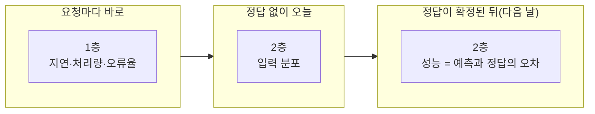
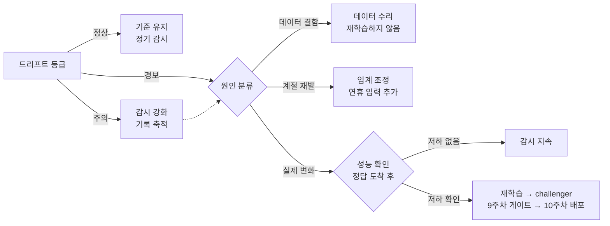

# 11주차 배포한 모델은 어떻게 낡고, 언제 다시 배워야 할까

> **11주차 · 모니터링**
>
> 1~6절은 **가상 사례**로 설명한다. 가람구는 실재하지 않는 자치구이며, 1~6절의 요청 건수·지연·민원 건수·날짜는 설명을 위해 만든 숫자이고, 평균·분위수·PSI는 그 숫자를 식에 넣어 계산한 값이다.
>
> 7절 실습의 수치는 모두 `practice/chapter11/`의 코드를 실행해 얻은 값이며, 인용한 값의 출처 파일은 출력 블록 첫 줄에 적었다. 다른 주차의 산출물을 가져다 쓴 곳에는 그 주차의 `practice/chapter{N}/data/output/` 경로를 함께 적었다.

□ 10주차에서 검증을 통과한 모델 이미지가 서버에서 운영 중이라고 가정함  
  ○ 배포는 모델 운영의 끝이 아니라 시작임  
  ○ 코드가 한 줄도 바뀌지 않아도 세상이 바뀌면 예측이 오류 없이 어긋남  
    – 그 어긋남은 서버 로그에 오류로 남지 않음  
□ 이 장은 그 어긋남을 무엇으로 측정하고, 신호가 떴을 때 무엇을 확인한 뒤 다시 배울지 정하는 절차를 다룬다  
□ 이 장의 순서  
  ○ 1~6절: 가람구에서 서비스를 운영하며 생기는 문제를 차례로 보면서 감시 방법을 설명함  
  ○ 7절: 그 감시 방법 가운데 입력 분포 비교를 실제 데이터로 실행함  

## 1. 오늘의 질문

□ 서버가 멀쩡한데 모델만 틀리기 시작하면 무엇으로 알아차릴까?  
□ "오늘 예측이 맞았는지"를 오늘 알 수 없는 과제에서는 무엇을 감시할까?  
□ 지표 두 개가 서로 다른 답을 내면 어느 쪽을 믿어야 할까?  
□ 드리프트(drift, 분포 변화) 경보가 떴다. 바로 다시 학습해도 될까?  

## 2. 사례 — 가람구 민원 건수 예측 서비스

□ 가람구는 9·10주차에서 만든 모델을 서버에 올려 7월 1일부터 운영함  
  ○ 서비스가 하는 일: 자치구의 전일 민원 건수를 받아 다음 날 민원 건수 예측을 돌려줌  
  ○ 운영 중인 모델은 9주차의 champion임. 학습 자료의 평균을 그대로 답하는 평균 예측기이므로, 어떤 입력에도 6.0을 답함  
    – 이 사실은 만든 설정이 아니라 실습 결과임. 9주차 `serving_via_alias`가 전일 9건 입력에 6.0을 답했고(`practice/chapter9/data/output/ch9_experiment_report.json`), 10주차의 컨테이너와 호스트도 같은 6.0을 냈음  
  ○ 구청 민원 부서의 대시보드와 민원 앱이 이 서비스를 하루 약 1,000번 호출함  
□ 운영을 시작한 뒤 석 달 동안 문제가 다섯 번 생김. 이 장은 이 다섯 문제를 순서대로 보면서 각 문제를 무엇으로 알아차리는지 설명함  

| 문제 | 날짜 | 무슨 일이 있었나 | 알아차리게 한 감시 항목 | 절 |
|---|---|---|---|---|
| 1 | 7월 8일 | 일부 요청만 2초씩 걸림 | 지연 — 평균이 아니라 분위수 | 3 |
| 2 | 7월 15일 | 요청이 평소의 10분의 1로 줄어듦 | 처리량 — 급락 | 3 |
| 3 | 7월 22일 | 입력 거절(422)이 하루 400건으로 늘어남 | 오류율 — 4xx와 5xx 구분 | 3 |
| 4 | 8월 1일~ | 오류는 0인데 예측이 실제보다 9건씩 적음 | 성능(정답 대조)과 입력 분포 | 4·5 |
| 5 | 9월 둘째 주 | 입력 분포 경보가 뜸 | 원인 분류와 재학습 판단표 | 6 |

**표 11.1** 가람구 서비스에서 생긴 다섯 문제

□ 문제 1~3은 서비스가 응답하는지를 묻는 감시(1층)로 잡히고, 문제 4~5는 예측이 맞는지를 묻는 감시(2층)가 있어야 잡힘. 두 층의 지표는 계산할 수 있는 시점이 다름  



**그림 11.1** 감시의 두 층과 각 지표를 계산할 수 있는 시점

## 3. 감시 1층 — 서비스가 응답하는가

□ 응답하지 않는 서비스에서는 예측 품질을 따질 수 없으므로, 모델과 무관한 세 질문부터 봄: 요청 하나가 얼마나 걸리는가(지연), 얼마나 많이 오는가(처리량), 얼마나 실패하는가(오류율)  

### 문제 1 — 평균은 정상인데 20명이 2초를 기다림 (7월 8일)

□ 7월 8일 하루 요청 1,000건의 지연이 다음과 같았음  
  ○ 980건은 3ms(0.003초)에 끝남  
  ○ 오전 9시 정각에 들어온 20건은 2,000ms(2초)가 걸림. 같은 서버에서 9시마다 백업 작업이 돌았기 때문임  
□ 평균으로 요약하면 문제가 보이지 않음  
  ○ 평균 = (980 × 3 + 20 × 2,000) ÷ 1,000 = 42,940 ÷ 1,000 ≈ 42.9ms  
  ○ 구청이 정한 목표가 "평균 100ms 이하"였다면 이날은 목표를 지킨 날로 기록됨. 2초를 기다린 20명은 이 숫자에 드러나지 않음  
□ 분위수로 보면 문제가 보임  
  ○ 분위수는 1,000건을 빠른 순서로 세웠을 때 특정 위치에 있는 값임  
    – p50: 가운데(500번째 근처) 값 = 3ms  
    – p95: 95% 위치(950번째 근처) 값 = 3ms  
    – p99: 99% 위치(990번째 근처) 값 = 2,000ms  
  ○ p99가 2,000ms이므로 "요청 100건 중 1건 이상이 2초 넘게 걸렸다"는 것을 바로 알 수 있음  
  ○ 그래서 운영 감시는 지연을 평균 하나가 아니라 p50·p95·p99를 나란히 놓고 봄  

### 문제 2 — 오류는 0인데 요청이 10분의 1로 줄어듦 (7월 15일)

□ 평소 하루 1,000건이던 요청이 7월 15일에 100건으로 줄었음. 지연과 오류율은 정상이었음  
□ 민원 부서가 서비스를 덜 쓰게 된 것이 아니었음  
  ○ 그 전날 민원 앱이 새 버전으로 바뀌면서 호출 주소 설정이 빠져, 앱의 요청이 이 서비스에 도착하지 않았음  
  ○ 서비스 쪽에서는 받은 요청을 모두 정상 처리했으므로 오류가 하나도 기록되지 않음  
□ 처리량은 갑자기 늘어날 때뿐 아니라 갑자기 줄어들 때도 확인해야 함  
  ○ 요청이 평소보다 크게 줄면, 이용이 줄었다고 보기 전에 요청을 보내는 쪽(상류)이 멈췄거나 바뀌었는지 먼저 확인함  

### 문제 3 — 422가 하루 400건으로 늘어남 (7월 22일)

□ 오류율은 4xx와 5xx를 나눠 셈  
  ○ 4xx와 5xx는 서버가 응답과 함께 돌려주는 세 자리 상태 코드(HTTP 상태 코드)이며, 첫 자리로 실패한 쪽이 나뉨  
    – 4xx는 요청을 보낸 쪽의 잘못임. 서버는 정상인데 요청이 규칙에 맞지 않아 거절함(예: 404 주소 없음, 422 입력 값이 규격에 맞지 않음)  
    – 5xx는 서버 쪽의 잘못임. 요청은 정상인데 서버가 처리하다 실패함(예: 500 서버 코드 오류, 503 과부하·점검으로 요청을 받을 수 없음)  
    – 성공한 응답은 2xx이며, 10주차에서 예측이 정상으로 돌아올 때 받은 200이 여기에 속함  
□ 가람구 서비스의 422는 평소 하루 3건 안팎이었음  
  ○ 10주차 실습에서 확인했듯 서빙 API는 규격에 맞지 않는 입력을 422로 거절함(`practice/chapter10/data/output/ch10_deploy_report.json`의 `invalid_input_status: 422`)  
  ○ 하루 3건의 422는 서비스가 입력 규격을 지킨 결과이므로 고장이 아님. 그러므로 오류율 0이 목표가 아님  
□ 7월 22일에는 422가 400건이었음  
  ○ 원인: 대시보드를 만드는 상류 시스템이 전일 민원 건수를 숫자 `9` 대신 글자 `"9건"`으로 보내기 시작했음  
  ○ 서비스는 정상이고, 요청을 보내는 쪽이 한꺼번에 규격을 어기기 시작한 것임. 그래서 422가 크게 늘면 상류의 데이터 형식(스키마) 변경(2주차)을 먼저 확인함  
□ 같은 날 오후에 503이 50건 나왔다면 이것은 서버 쪽 문제이므로 서비스 담당자가 서버를 고쳐야 함  
□ 감시 규칙은 "422가 나왔다"가 아니라 "422가 평소보다 크게 늘었다"를 봄. 5xx는 적은 수라도 서버 고장을 뜻하므로 따로 셈  

## 4. 감시 2층 — 예측이 맞는가

### 문제 4 — 오류 0, 응답 정상, 예측만 틀림 (8월 1일~)

□ 8월 1일 가람구가 "생활불편 신고 앱"을 새로 열었음  
  ○ 그 뒤 하루 민원 건수가 평소 6건 안팎에서 15건 안팎으로 늘었음  
  ○ 서비스는 여전히 매일 6.0을 답함. 평균 예측기는 입력을 보지 않기 때문임  
□ 1층 감시에는 아무것도 나타나지 않음  
  ○ 지연·처리량·오류율이 모두 평소와 같고, 응답은 전부 200임  
  ○ 서버는 정상이고 예측만 실제와 9건씩 어긋남  
□ 이 고장을 알아차리려면 "예측이 맞는가"를 묻는 2층 감시가 따로 있어야 함  

### 정답이 늦게 도착한다 — 레이블 지연

□ 2층에서 가장 직접적인 지표는 성능임. 예측과 실제 값(정답)을 대조해 오차를 계산함  
□ 그런데 정답이 늦게 옴  
  ○ 8월 1일의 실제 민원 건수(15건)는 8월 1일이 끝나야 확정됨. 예측이 9건 틀렸다는 사실은 8월 2일 아침에야 알 수 있음  
  ○ 심사 결과나 재방문 여부처럼 정답 확정에 며칠에서 몇 주가 걸리는 과제도 있음  
□ 정답이 늦게 도착하는 것을 **레이블 지연**이라고 부름. 이 때문에 모델 감시는 정답이 도착하는 순서대로 나뉨  
  ○ 정답 없이 지금 볼 수 있는 것은 입력 분포(모델이 받는 값들의 분포)와 예측 분포(모델이 내는 값들의 분포)임  
  ○ 정답이 도착하면 성능을 계산해 확정 판정을 내림  
  ○ 그래서 감시를 설계할 때 첫 질문은 "어떤 지표를 볼까"가 아니라 <strong>"이 과제의 정답은 언제 도착하는가"</strong>임  
    – 정답 확정에 몇 달이 걸리는 과제에서는 입력 분포가 사실상 유일하게 볼 수 있는 신호임  
□ 가람구 모델은 매일 6.0을 답하므로 예측 분포는 8월 이후에도 바뀌지 않음. 바뀐 것은 입력(전일 민원 건수가 8월 2일부터 15건 안팎)뿐임  
  ○ **입력에 둔감한 모델일수록 예측 분포가 아니라 입력 분포를 직접 감시해야 한다.** 7절 실습이 하는 일이 입력 분포 비교임  

### 무엇이 바뀌었나 — 데이터 드리프트와 컨셉 드리프트

□ 모델은 학습할 때의 데이터를 전제로 답함. 그 전제가 깨지는 방식이 둘이고, 둘은 알아차리는 데 필요한 자료가 다름  
□ **데이터 드리프트**는 입력 값의 분포가 바뀌는 것임  
  ○ 가람구 예: 8월 휴가철에 전일 민원 건수 입력이 평소 4~8건에서 2~5건으로 내려감. 입력과 다음 날 건수의 관계는 그대로임  
  ○ 입력 기록만 있으면 알 수 있으므로 정답을 기다릴 필요가 없음  
□ **컨셉 드리프트**는 입력과 정답의 관계가 바뀌는 것임  
  ○ 가람구 예: 신고 앱이 생긴 뒤에는 전일 9건이었던 날의 다음 날 건수가 예전보다 많음. 같은 입력에 대한 정답이 바뀐 것임  
  ○ 관계가 바뀐 것이므로 정답을 받아야 확인되며, 레이블 지연만큼 늦게 알게 됨  
□ 두 가지 함정이 있음  
  ○ 입력 분포가 그대로여도 관계는 바뀔 수 있음. 입력만 감시하면 이 변화를 놓침  
  ○ 반대로 입력 분포가 바뀌어도 성능은 그대로일 수 있음. 모델이 반응하지 않는 쪽으로 입력이 바뀐 경우임  
□ 두 함정을 합치면 이 장에서 가장 중요한 설계 원칙이 나옴  
  ○ **드리프트 경보는 "성능이 떨어졌다"는 확정이 아니라 "확인을 시작하라"는 신호로 설계한다.**  
  ○ 6절의 판단표가 이 원칙을 절차로 옮긴 것임  

## 5. 입력 분포는 무엇과 무엇을 어떻게 비교하나

### 비교할 두 묶음을 같은 조건으로 고른다

□ 입력 분포 감시는 **기준 묶음**(학습할 때 또는 정상이던 때의 입력)과 **현재 묶음**(최근 입력)을 비교함  
□ 두 묶음의 조건이 다르면 그 차이가 결과에 섞임  
  ○ 가람구 예: 민원은 주말에 적음. 기준을 평일 30일로, 현재를 주말이 낀 최근 7일로 잡으면 요일 차이만으로 분포가 달라 보임  
  ○ 그러면 분포가 달라져도 "세상이 바뀌어서"인지 "요일이 달라서"인지 말할 수 없음  
□ 그래서 요일·시각·대상 범위를 맞춘 두 묶음을 고르는 것이 입력 분포 감시의 첫 단계임  

### 두 지표 — KS 검정과 PSI

□ 두 묶음이 다른지 판단하는 지표는 여럿이며, 이 장은 둘을 함께 씀  
□ **KS 2표본 검정**(2주차에서 다룸)은 "이 차이를 우연으로 보기 어려운가"를 묻는 지표임  
  ○ 두 묶음을 각각 작은 값부터 쌓아 "이 값 이하인 비율"을 그린 선(누적분포)을 만들고, 두 선이 가장 멀리 벌어진 간격 D를 구함  
  ○ p는 "두 묶음이 같은 분포에서 나왔다"고 가정했을 때 D가 이만큼 이상 나올 확률임. p가 유의수준 0.05보다 작으면 "유의하다(우연으로 보기 어렵다)"고 판정함  
  ○ p가 크다는 것은 "분포가 같다"가 아니라 "다르다고 볼 증거가 부족하다"는 뜻임  
□ <strong>PSI(Population Stability Index, 모집단 안정성 지수)</strong>는 "구간별 비율이 얼마나 옮겨 갔는가"를 묻는 지표임  
  ○ 기준 묶음을 값 크기 순으로 다섯 구간(각 20%)으로 나누고, 현재 묶음이 각 구간에 몇 개씩 들어가는지 셈  
  ○ 구간마다 아래 값을 계산해 모두 더함  

```
PSI = Σ (현재 비율 − 기준 비율) × ln(현재 비율 ÷ 기준 비율)
```

  ○ 비율이 0인 구간이 있으면 ln을 계산할 수 없으므로, 구간마다 0.5개를 더한 뒤 비율을 계산함  
  ○ 신용평가 업계의 관행 임계는 0.1 이상을 주의, 0.25 이상을 경보로 봄. 이 임계에 통계적 근거가 약하다는 지적이 있으므로(Yurdakul 2018), 자료에 맞게 조정할 수 있음  

□ 가람구 예로 PSI를 계산함  
  ○ 기준 묶음: 6월 30일 동안의 전일 민원 건수 30개. 다섯 구간에 6개씩 들어감(구간 비율은 각 0.2)  
  ○ 현재 묶음 두 가지를 비교함: 7월 30일(평소)과 8월 30일(신고 앱 개설 뒤)  

| 구간(기준 묶음으로 나눔) | 기준 | 7월 | 8월 |
|---|---:|---:|---:|
| 1구간(가장 적음) | 6 | 5 | 1 |
| 2구간 | 6 | 6 | 2 |
| 3구간 | 6 | 6 | 4 |
| 4구간 | 6 | 7 | 8 |
| 5구간(가장 많음) | 6 | 6 | 15 |
| **PSI** | — | **0.0095** | **0.6230** |

**표 11.2** 가람구 전일 민원 건수의 구간별 일수와 PSI(PSI는 0.5를 더하는 규칙으로 계산한 값)

  ○ 7월은 구간마다 많아야 1일 차이 나므로 PSI가 0.0095로 0.1보다 훨씬 작음 → 정상  
  ○ 8월은 가장 많은 5구간이 6일에서 15일로 늘고 가장 적은 1구간이 6일에서 1일로 줄었으므로 PSI가 0.6230으로 0.25를 넘음 → 경보 대역  
    – 숫자를 넣은 예: 5구간은 기준 비율 (6 + 0.5) ÷ 32.5 = 0.2, 8월 비율 (15 + 0.5) ÷ 32.5 = 0.4769이므로 (0.4769 − 0.2) × ln(0.4769 ÷ 0.2) = 0.2769 × 0.869 ≈ 0.2407  
    – 1구간은 (1 + 0.5) ÷ 32.5 = 0.0462이므로 (0.0462 − 0.2) × ln(0.0462 ÷ 0.2) ≈ 0.2256. 비율이 줄어든 구간도 PSI를 키움  

### 두 지표가 다른 답을 낼 때 — 등급 규칙

□ KS는 "우연인가"를, PSI는 "얼마나 옮겨 갔나"를 물으므로 같은 두 묶음에 다른 답을 낼 수 있음  
  ○ 묶음이 크면(예: 요청 수만 건) 아주 작은 차이도 KS에서 유의로 나옴. 이때는 PSI로 차이의 크기를 확인해야 함  
  ○ 묶음이 작으면(예: 30일) 며칠만 구간을 옮겨도 PSI가 크게 나옴. 이때는 KS로 우연인지 확인해야 함  
□ 그래서 이 장은 두 지표를 함께 넣어 등급을 정함  

| 등급 | 조건 | 할 일 |
|---|---|---|
| 경보 | KS 유의 **AND** PSI ≥ 0.25 | 담당자를 부르고 원인 분류를 우선함 |
| 주의 | KS 유의 **OR** PSI ≥ 0.1 (경보가 아닐 때) | 담당자를 부르지 않고 기록을 쌓으며 원인 분류를 시작함 |
| 정상 | 둘 다 아님 | 기준을 유지하고 정기 감시를 이어 감 |

**표 11.3** 알림 등급 규칙

□ 경보에 두 조건을 **AND**로 묶은 이유  
  ○ OR로 묶으면 둘 중 하나만 넘어도 경보가 됨. 묶음이 작을 때 PSI가 0.25를 넘는 일이 잦으므로 경보가 자주 울림  
  ○ 틀린 경보를 여러 번 받은 담당자는 다음 경보를 확인하지 않게 됨. 그래서 담당자를 부르는 일은 두 지표가 모두 넘은 경우에만 함  
□ 7절 실습의 9일 간격 비교에서 실제로 두 지표가 다른 답을 냄(PSI는 경보 대역, KS는 유의하지 않음)  

## 6. 경보 뒤에 할 일 — 재학습 판단

### 문제 5 — 월요일 아침의 경보 (9월 둘째 주)

□ 9월 둘째 주 월요일 아침, 대시보드에 입력 분포 경보가 떴음. 당직자는 재학습을 바로 실행하지 않고 원인부터 확인함  
□ 경보의 원인은 셋 중 하나이며, 원인마다 확인할 곳과 할 일이 다름  
  ○ **데이터 결함** — 예: 주말 수집 배치가 멈춰 일요일 민원이 0건으로 기록됨. 상류 수집 로그에서 확인함. 0건이 섞인 데이터로 재학습하면 0건을 정상으로 배운 모델이 나오므로, 재학습하지 않고 데이터를 수리함  
  ○ **계절 재발** — 예: 직전 주가 추석 연휴였음. 달력에서 확인함. 매년 연휴마다 경보가 울리면 담당자가 경보를 무시하게 되므로, 임계를 조정하거나 연휴 여부를 입력 항목으로 추가함  
  ○ **실제 변화** — 예: 8월의 신고 앱처럼 제도나 서비스가 바뀜. 정책 공지에서 확인함. 이때에만 재학습이 후보가 됨  
□ 원인이 실제 변화여도 **성능 확인**을 한 번 더 거침. 4절에서 봤듯 입력 분포가 바뀌어도 성능은 그대로일 수 있기 때문임  
  ○ 월요일 아침에는 일요일의 실제 건수가 아직 확정되지 않아 성능을 확인할 수 없음. 그래서 이날의 조치는 재학습 결재가 아니라 원인 분류 시작과 기록 축적임  



**그림 11.2** 경보 뒤 판단 순서 — 재학습은 원인이 실제 변화이고 성능 저하가 확인된 경우에만 실행함

□ 재학습을 언제 실행할지 정하는 방식은 셋임  
  ○ 정기 실행: 주기마다 무조건 재학습함. 단순하지만 변화가 없어도 비용이 듦  
  ○ 경보 기반 실행: 판단표가 재학습을 가리킬 때만 실행함. 비용은 적지만 감시 장치를 먼저 갖춰야 함  
  ○ 실무에서는 둘을 섞어, 정기 재학습을 기본으로 두고 경보가 뜨면 앞당겨 실행함  
□ 어느 방식이든 재학습한 모델은 champion을 곧바로 교체하지 않고 **challenger로 9주차 승격 게이트를 다시 통과한 뒤** 10주차 배포를 밟음(그림 11.2 아래쪽). 게이트를 건너뛰면 9주차에서 남긴 승인 기록이 그 모델부터 끊김  
  ○ 감시(11주차)에서 재학습을 거쳐 다시 9주차로 돌아오므로, MLOps는 한 방향의 파이프라인이 아니라 반복되는 순환임  

## 7. 실습 — 미세먼지 값으로 입력 분포 비교를 실행한다

### 실행 파일이 푸는 과제

□ 이 장의 실행 파일은 한 가지 질문에 숫자로 답함: **"기준 시각의 값 묶음과 지금의 값 묶음이 서로 다른 분포인가"**  
  ○ 값 묶음은 서울 40개 측정소가 같은 시각에 측정한 미세먼지(PM10, 지름 10㎛ 이하 먼지의 농도, 단위 ㎍/㎥) 값 40개임  
    – 2026-06-28 22:00의 40개 값을 **기준**으로 둠  
    – 비교 대상은 두 묶음임. 1시간 뒤(6/28 23:00)의 40개 값이 비교 A, 9일 뒤 같은 시각(7/7 22:00)의 40개 값이 비교 B임  
  ○ 세 묶음은 1주차에서 쓴 에어코리아 실시간 측정 API로 받아 `practice/chapter11/data/input/`에 JSON 파일로 저장해 두었음  
□ 실행 파일은 두 묶음을 받아 여섯 단계를 차례로 출력함  

| 단계 | 하는 일 | 출력에서 볼 값 |
|---|---|---|
| [1] 입력 | 두 파일을 읽고 측정소별 값을 짝지음 | 측정소 수, 평균, 오른 곳·내린 곳 수 |
| [2] 구간 나누기 | 기준 값으로 경계를 정해 5구간으로 나누고 구간마다 측정소 수를 셈 | 구간별 측정소 수와 비율 |
| [3] KS 검정 | 두 묶음의 차이를 우연으로 보기 어려운지 확률로 계산 | D, p |
| [4] PSI | 구간마다 비율이 얼마나 옮겨 갔는지 더함 | 구간별 기여값과 합계 |
| [5] 등급 판정 | [3]과 [4]의 결과를 규칙에 넣어 정상·주의·경보 중 하나로 정함 | 조건식과 등급 |
| [6] 권고 | 등급에 따라 사람이 할 일을 적음 | 권고 문장 |

**표 11.4** 실행 파일이 출력하는 여섯 단계

□ 학습 시점 입력을 기준 묶음, 오늘 입력을 현재 묶음으로 넣으면 같은 여섯 단계가 모델 입력 감시가 됨. 이 실습은 미세먼지 값을 넣었으므로, 여기서 나온 등급은 대기질 값 분포에 대한 판정이며 민원 예측 모델의 상태가 아님  

### 준비

□ 실행하기 전에 네 가지를 먼저 적음  
  ○ 산출물을 먼저 열면 거기 적힌 값이 정답으로 보여 "왜 이 값인가"를 묻지 않게 됨  

**표 11.5** 예측표 — 실행하기 **전에** 채운다

| 예측할 것 | 내 예측 | 실제 | 어긋났다면 원인 |
|---|---|---|---|
| 같은 날 1시간 간격 비교에서 PSI가 주의 임계 0.1을 넘는가 | | | |
| 9일 간격 비교에서 KS 검정이 유의(p<0.05)하게 나오는가 | | | |
| 9일 간격 비교의 알림 등급은 정상·주의·경보 중 무엇인가 | | | |
| 9일 뒤 비교에서 40개 측정소 중 몇 곳이 최하 구간(17 미만)에 들어가는가 | | | |

□ 이 장에서 실행할 코드는 둘이고 하나는 선택임  

| 순서 | 실행할 파일 | 하는 일 | 절 | 선행 조건 |
| ---: | --- | --- | ---: | --- |
| 1 | `run_chapter11.py` | 비교 A·B를 차례로 돌리고 보고서를 만듦 | 7 | `code/requirements.txt` 설치 |
| 2 | `code/11-1-drift-monitoring.py` | 기준·현재 한 쌍만 비교(기본값이 비교 B) | 7 | 위와 같음 |
| 선택 | `code/11-0-collect-snapshot.py` | 스냅샷(snapshot)을 새로 수집 | — | data.go.kr 인증키 |

○ 1번이 2번을 두 번 호출하므로 1번만 실행해도 이 장의 산출물이 전부 생김  
○ Docker나 서버가 필요 없고 Python과 numpy·pandas·scipy만 있으면 됨  

```bash
cd practice/chapter11
python3 -m venv venv && source venv/bin/activate   # Windows: venv\Scripts\activate
pip install -r code/requirements.txt
```

> - **선택 실습인 `11-0-collect-snapshot.py`는 인증키가 없으면 실행하지 않는다**
> - 이 스크립트는 `data/input/`의 스냅샷 파일을 덮어쓴다. 저장소에 커밋된 세 스냅샷이 이 장의 기준선이므로, 덮어쓰면 본문의 수치와 대조할 수 없게 된다.
> - 1주차에서 만든 인증키가 있고 수집 절차를 직접 보고 싶을 때만 `--out`을 새 파일명으로 지정해 실행한다.

### 실행

□ 스냅샷에는 측정값만 있고 정답 열이 없으므로, 이 실습으로 확인할 수 있는 것은 데이터 드리프트뿐임  
□ 비교 B를 기준과 **같은 22:00**으로 고른 것은 5절의 조건 맞추기임. PM10은 하루 안에서도 오르내리므로 시각이 다르면 9일 동안의 변화와 시각 차이로 생긴 변화가 섞임  

□ 실습을 실행함. 7절의 숫자는 전부 이 명령과 아래 비교 B 명령의 출력임  

```bash
cd practice/chapter11
python run_chapter11.py
```

□ `run_chapter11.py`는 실행 파일 `code/11-1-drift-monitoring.py`를 두 번 부름. 화면에는 비교 A의 [1]~[6], 2주차 재현 확인, 비교 B의 [1]~[6], 마지막 줄 `CH11_RUN_PASS`가 차례로 나옴  

### 비교 A — 1시간 간격

```text
# 출처: practice/chapter11/results/run_chapter11.log (비교 A 발췌)
=== 비교 A: 22:00 vs 23:00 (6/28, 2장 재현 검증) ===
...
    두 시각에 모두 있는 측정소 40곳: 오름 21곳, 내림 14곳, 같음 5곳
...
    [-inf, 17.0)       7         3     0.1765     0.0824
...
    p = 0.5786  → 유의수준 0.05보다 크다 → 유의하지 않음
...
    합계 PSI = 0.1193  (관행 임계: 0.1 이상 주의, 0.25 이상 경보 → 주의 대역)
...
    등급 = 주의
...
2장 실측 재현: True
```

□ 비교 A에서 읽을 것  
  ○ **`2장 실측 재현: True`를 먼저 확인함** — 같은 두 묶음으로 2주차가 얻은 KS 0.175와 p 0.5786이 그대로 다시 나왔음(`practice/chapter2/data/output/ch2_drift_result.json`). 옛 지표가 같은 값을 내는지 확인해 두면, 나중에 값이 달라졌을 때 원인이 자료인지 코드인지 가를 수 있음  
  ○ **1시간 사이에 40곳 중 35곳의 값이 바뀌었지만 KS는 유의하지 않음**(p = 0.5786)  
  ○ **그런데 PSI는 0.1193으로 주의 대역에 들어가 등급이 주의로 나옴** — 대기질이 1시간 만에 나빠졌다는 뜻이 아님  
    – 5구간에 40곳을 나누면 구간당 8곳 안팎이므로, 최하 구간에서 측정소 4곳(7곳 → 3곳)이 빠지기만 해도 그 구간 비율이 약 9%p(0.1765 → 0.0824) 바뀜  
    – 관행 임계를 이렇게 작은 묶음에 그대로 적용하면 평소에도 매시간 주의가 나올 수 있음  

```text
# 출처: practice/chapter11/results/run_chapter11.log (마지막 두 줄)
보고서 저장: data/output/ch11_drift_report.json
CH11_RUN_PASS
```

□ 마지막 줄에서 읽을 것  
  ○ **`CH11_RUN_PASS`가 나와야 위아래 수치를 읽음** — 2주차 재현, 두 비교의 현재 시각(23:00과 7/7 22:00), 등급 값, 구간 수 5개, 보고서 파일 생성을 모두 확인했다는 뜻임  
  ○ 하나라도 어긋나면 이 줄 대신 `CH11_RUN_FAIL(…)`이 나오고 괄호 안에 어긋난 항목이 적힘  

### 비교 B — 9일 간격, 단계별로 읽기

□ 비교 B(9일 간격)만 따로 실행함. 실행 파일의 기본값이 비교 B의 두 파일이므로 인자 없이 실행해도 같은 비교가 나옴  

```bash
cd practice/chapter11
python code/11-1-drift-monitoring.py
```

#### [1] 입력 — 같은 측정소의 값이 어떻게 바뀌었나

```text
# 출처: practice/chapter11/results/11-1-drift-monitoring.log ([1])
[1] 입력 — 서울 측정소의 pm10Value 값 두 묶음
    기준 airquality_seoul_2200_0628.json  시각 2026-06-28 22:00  측정소 40곳  평균 20.025
    현재 airquality_seoul_2200_0707.json  시각 2026-07-07 22:00  측정소 40곳  평균 17.75
    두 시각에 모두 있는 측정소 40곳: 오름 9곳, 내림 26곳, 같음 5곳
    예(가나다순 앞 3곳): 강남구 21→21, 강남대로 17→14, 강동구 27→10
```

□ [1]에서 읽을 것  
  ○ **파일 이름과 시각을 먼저 확인함** — 기준과 현재가 모두 22:00이므로 시각 차이로 생긴 변화는 섞이지 않았음  
  ○ **40곳 중 26곳이 내렸음** — 오른 곳은 9곳이고, 평균은 20.025에서 17.75로 2.275 내려갔음  
  ○ **측정소마다 바뀐 폭이 다름** — 강남구는 21 그대로이고, 강동구는 27에서 10으로 17 내려갔음  
  ○ 평균 하나로는 "얼마나 많은 측정소가 어느 쪽으로 움직였는가"를 알 수 없음. 그래서 [2]에서 값 40개를 구간으로 나눠 셈  

#### [2] 구간 나누기 — 기준 값으로 경계를 정한다

```text
# 출처: practice/chapter11/results/11-1-drift-monitoring.log ([2])
[2] 구간 나누기 — 기준 값의 분위수로 경계를 정해 5구간으로 나눔
    구간           기준(곳)  현재(곳)  기준 비율  현재 비율
    [-inf, 17.0)       7        13     0.1765     0.3176
    [17.0, 19.0)       5         7     0.1294     0.1765
    [19.0, 21.0)      10        11     0.2471     0.2706
    [21.0, 22.0)       5         5     0.1294     0.1294
    [22.0, inf)       13         4     0.3176     0.1059
    비율 = (구간 측정소 수 + 0.5) ÷ (40 + 0.5×5) — 0곳인 구간에서 ln 계산이 막히지 않게 0.5를 더함
```

□ 구간 경계를 정하는 방법  
  ○ 기준 값 40개를 작은 순서로 세웠을 때 하위 20%·40%·60%·80% 위치의 값(분위수)이 경계가 됨. 이 실습에서는 17, 19, 21, 22였음  
  ○ 경계를 기준 값으로만 정하므로, 현재 값이 바뀌어도 경계는 그대로임  
  ○ 맨 아래 구간은 `-inf`(아래 끝 없음), 맨 위 구간은 `inf`(위 끝 없음)까지 열어 둠  
    – 현재 값이 기준의 최솟값보다 작거나 최댓값보다 커도 버려지지 않고 양 끝 구간에 들어감. 기준 범위를 벗어난 값은 변화를 보여 주는 값이기 때문임  
  ○ 측정값이 정수라 같은 값이 여러 개이므로 구간마다 정확히 8곳씩 나뉘지 않음. 기준 구간별 수가 7·5·10·5·13곳인 이유임  
□ 비율은 5절과 같이 구간마다 0.5를 더해 계산함. 기준 최하 구간은 7 ÷ 40 = 0.175가 아니라 (7 + 0.5) ÷ (40 + 2.5) = 0.1765임  
□ [2]에서 읽을 것  
  ○ **분포 전체가 아래로 이동했음** — 최하 구간(17 미만)이 7곳에서 13곳으로 늘었고, 최상 구간(22 이상)이 13곳에서 4곳으로 줄었음  
  ○ **[21, 22) 구간은 5곳 그대로임** — 이 구간은 [4]에서 PSI에 0을 더함  

#### [3] KS 검정 — 이 차이를 우연으로 보기 어려운가

```text
# 출처: practice/chapter11/results/11-1-drift-monitoring.log ([3])
[3] KS 검정 — 이 차이를 우연으로 보기 어려운가
    D = 0.225  (두 누적분포가 가장 멀리 벌어진 간격)
    p = 0.2657  → 유의수준 0.05보다 크다 → 유의하지 않음
```

□ [3]에서 읽을 것  
  ○ **D = 0.225** — 어떤 값 이하인 측정소 비율이 기준과 현재에서 최대 22.5%p(40곳 중 9곳) 차이 남  
  ○ **p = 0.2657은 유의수준 0.05보다 큼** — 측정소 40곳만으로는 우연을 배제할 근거가 부족함. 같은 D라도 측정소 수가 많으면 p가 작아짐  

#### [4] PSI — 구간마다 비율이 얼마나 옮겨 갔나

```text
# 출처: practice/chapter11/results/11-1-drift-monitoring.log ([4])
[4] PSI — 구간마다 (현재 비율 − 기준 비율) × ln(현재 비율 ÷ 기준 비율)을 더함
    [-inf, 17.0)  (0.3176 − 0.1765) × ln(0.3176 ÷ 0.1765) = 0.0830
    [17.0, 19.0)  (0.1765 − 0.1294) × ln(0.1765 ÷ 0.1294) = 0.0146
    [19.0, 21.0)  (0.2706 − 0.2471) × ln(0.2706 ÷ 0.2471) = 0.0021
    [21.0, 22.0)  (0.1294 − 0.1294) × ln(0.1294 ÷ 0.1294) = 0.0000
    [22.0, inf)   (0.1059 − 0.3176) × ln(0.1059 ÷ 0.3176) = 0.2326
    합계 PSI = 0.3324  (관행 임계: 0.1 이상 주의, 0.25 이상 경보 → 경보 대역)
    확인: KL(기준→현재) 0.1826 + KL(현재→기준) 0.1497 = PSI 와 같은가 → True
```

□ 계산 방법은 5절의 가람구 예와 같음. [2]의 구간마다 (현재 비율 − 기준 비율) × ln(현재 비율 ÷ 기준 비율)을 계산해 더함  
  ○ 최상 구간: (0.1059 − 0.3176) × ln(0.1059 ÷ 0.3176) = (−0.2117) × (−1.098) ≈ 0.2326  
  ○ 비율이 줄어든 구간은 두 항이 모두 음수이므로 곱이 양수가 되어 PSI를 키움  
□ [4]에서 읽을 것  
  ○ **합계 0.3324는 경보 임계 0.25를 넘음** — PSI만 보면 경보 대역임  
  ○ **합계의 약 70%가 최상 구간 한 곳에서 나옴** — 0.2326 ÷ 0.3324 ≈ 0.70. 22 이상이던 측정소가 13곳에서 4곳으로 줄어든 변화가 PSI의 대부분을 만들었음  
  ○ **[21, 22) 구간의 기여는 0임** — 측정소 수가 5곳 그대로이므로 두 비율이 같음  
  ○ 다섯 기여값을 그대로 더하면 0.3323으로 합계와 0.0001 차이 남. 기여값을 넷째 자리에서 반올림해 적었기 때문임. 마지막 줄의 KL 관계는 10절 더 알아보기에서 다룸  
□ [3]과 [4]를 합치면: "옮겨 간 크기는 경보 수준(PSI 0.3324)이지만, 측정소 40곳으로는 우연을 배제할 수 없다(p = 0.2657)". 5절에서 설명한 "묶음이 작으면 PSI가 크게 나오는" 경우임  
  ○ 1시간 간격(비교 A)보다 KS D는 0.175 → 0.225, PSI는 0.1193 → 0.3324로 커졌음  

#### [5] 등급 판정 — 두 지표를 규칙에 넣는다

```text
# 출처: practice/chapter11/results/11-1-drift-monitoring.log ([5])
[5] 등급 판정 — 경보 = KS 유의 AND PSI≥0.25, 주의 = KS 유의 OR PSI≥0.1
    KS 유의 = False, PSI≥0.25 = True, PSI≥0.1 = True
    경보 조건: False AND True → False
    주의 조건: False OR True → True
    등급 = 주의
```

□ [5]에서 읽을 것(규칙은 표 11.3, 코드는 `judge_alert` 함수)  
  ○ **경보 조건부터 검사함** — KS 유의가 False이므로 PSI가 0.25를 넘었어도 `False AND True`는 False임  
  ○ **다음으로 주의 조건을 검사함** — PSI가 0.1 이상이므로 `False OR True`는 True이고, 등급은 주의로 정해짐  
  ○ PSI만 보면 경보 대역이었지만 규칙이 한 단계 낮은 주의로 정했음. OR로 묶었다면 경보가 되어 담당자를 불렀을 것임  

#### [6] 권고 — 등급에서 바로 재학습으로 가지 않는다

```text
# 출처: practice/chapter11/results/11-1-drift-monitoring.log ([6])
[6] 권고 조치
    모니터링 강화 + 원인 분류 착수(계절/정책/시스템 변경/데이터 결함)
```

□ [6]에서 읽을 것  
  ○ **주의 등급의 권고는 "재학습"이 아니라 "원인 분류 착수"임** — 담당자를 부르지 않고 기록을 쌓으면서 왜 분포가 바뀌었는지 확인을 시작함  
  ○ 경보 등급이었다면 권고는 "원인 분류 우선 — 데이터 결함이면 수리, 실제 분포 변화면 재학습 후보 데이터 확보 후 9장 승격 게이트로"가 됨(`recommend_action` 함수). 경보에서도 재학습을 바로 실행하지 않음  
  ○ 원인 분류를 어떻게 하는지는 6절에서 다룸  

### 보고서 파일

□ 실습이 만든 보고서에는 판정에 쓴 규칙과 권고가 지표와 분리되어 기록됨  

```json
# 출처: practice/chapter11/data/output/ch11_drift_report.json
"alert_rule": {
  "ks": "p < 0.05 (2장과 동일 alpha)",
  "psi": "0.1 주의 / 0.25 경보 (신용평가 업계 관행 — Yurdakul 2018)",
  "combine": "경보=KS유의 AND PSI>=0.25, 주의=둘 중 하나, 정상=둘 다 미달" },
"comparison_a_matches_ch2": true,
"notes": [
  "비교창 정렬: 기준·현재 모두 22:00 정시 — 일중 변동 교란을 설계로 제거",
  "n=40 소표본 — KS 검정력 낮음, PSI 구간당 기대 8건으로 출렁임에 민감",
  "알림≠재학습: 권고 조치는 원인 분류를 먼저 요구(11.4)" ]
```

□ 보고서에서 읽을 것  
  ○ **판정 규칙이 파일 안에 글자로 남음** — 나중에 등급을 두고 이견이 생기면 그때 쓴 임계와 조합 방식을 파일에서 확인함  
  ○ **측정소 40곳이라는 한계도 같은 파일에 적힘** — 판정의 약점을 결과와 함께 남겨야 나중에 검토하는 사람이 판정을 다시 따질 수 있음  

## 8. 핵심 요약

□ **1. 감시는 두 층이다.** 1층(지연·처리량·오류율)은 서비스가 응답하는지만 보므로, 응답은 정상인데 예측만 틀리는 고장(문제 4)은 2층이 있어야 잡힘  
□ **2. 1층 지표는 한 숫자로 요약하지 않는다.** 지연은 p50·p95·p99로, 처리량은 급락까지, 오류율은 4xx 급증과 5xx 발생을 나눠 봄  
□ **3. 정답이 언제 도착하는가가 무엇을 감시할지 정한다.** 정답을 기다리는 동안에는 입력 분포를 보며, 입력에 둔감한 모델일수록 입력 분포를 직접 감시함  
□ **4. 입력 분포는 조건을 맞춘 두 묶음을 KS와 PSI로 함께 비교한다.** 실습의 9일 비교에서 PSI 0.3324는 경보 대역이었지만 KS는 p = 0.2657로 유의하지 않아, AND 규칙이 등급을 주의로 정했음  
□ **5. 경보에서 재학습까지는 원인 분류와 성능 확인을 거친다.** 데이터 결함이면 수리, 계절 재발이면 임계 조정이며, 재학습한 모델도 9주차 게이트를 다시 통과함  

## 9. 과제

□ 실습을 실행해 만든 `practice/chapter11/data/output/ch11_drift_report.json`을 LMS에 업로드한다  
□ 이어서 세 가지를 각각 세 문장 이내로 쓴다  

1. 본인 산출물의 두 비교에서 `ks_significant`와 `psi_band`가 어떻게 엇갈렸는지 값으로 적고, 그럼에도 `alert_level`이 그렇게 정해진 과정을 `alert_rule`의 `combine` 규칙으로 재현한다.
2. `combine` 규칙이 KS와 PSI를 AND로 묶은 이유를 쓰고, OR로 묶었다면 운영에서 무엇이 달라졌을지 쓴다.
3. 드리프트 경보와 성능 저하가 함께 확인됐는데 원인이 데이터 결함으로 밝혀졌다면 왜 재학습을 실행하면 안 되는지, 그때 어떤 모델이 나오는지로 설명한다.

□ 수업일 포함 7일 이내에 제출한다  

## 10. 더 알아보기

□ 이 장에서 자른 내용은 아래에서 이어 볼 수 있음  
  ○ **PSI와 KL divergence의 관계** — 산출물의 `psi_equals_kl_sum`이 `true`인 것은 PSI가 양방향 KL의 합과 같다는 항등식을 수치로 확인한 결과임. 구간 확률과 스무딩 처리는 `practice/chapter11/code/11-1-drift-monitoring.py`의 `binned_proportions`·`psi_and_kl` 함수에 있음  
  ○ **구간 수를 바꿔 보기** — `11-1-drift-monitoring.py`에 `--bins 10`을 주면 같은 자료에서 PSI가 어떻게 달라지는지 볼 수 있음. 구간 수가 다르면 PSI끼리 비교할 수 없다는 경고가 코드에 들어 있음  
  ○ **스냅샷 수집 절차** — 정시 데이터가 정시보다 늦게 게시되는 문제를 폴러로 다루는 방법: `practice/chapter11/code/11-0-collect-snapshot.py`와 `practice/chapter11/data/output/ch11_collect_log.txt`  
  ○ **골든 시그널의 원문** — 지연·트래픽·오류·포화 네 가지의 정의: <https://sre.google/sre-book/monitoring-distributed-systems/>  
  ○ **KS 2표본 검정의 계산 규약** — <https://docs.scipy.org/doc/scipy/reference/generated/scipy.stats.ks_2samp.html>  
  ○ **피처가 바뀔 때의 감시** — 입력 자체의 정의가 바뀌는 경우의 관리는 12주차, 감시까지 포함한 통합 사례는 13주차, 생성형 모델의 감시는 14주차에서 다룸  
